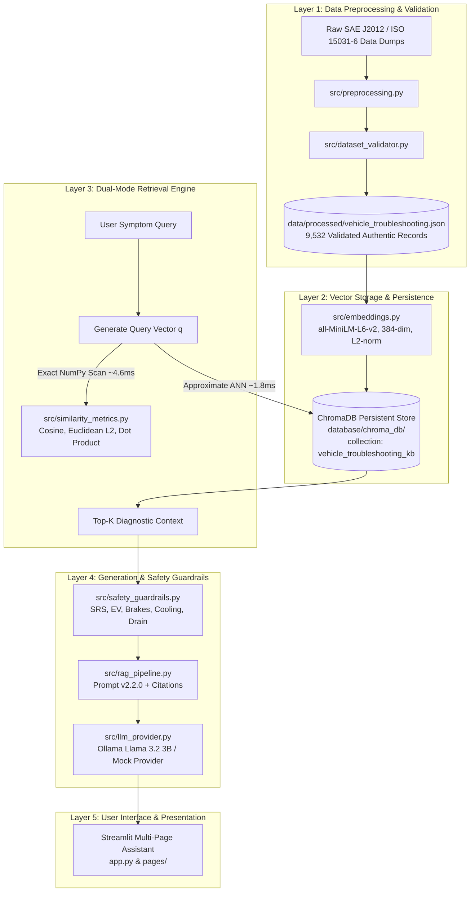

# Vehicle Troubleshooting Assistant using ChromaDB and Retrieval-Augmented Generation (RAG)

**Course:** Modern Database Systems (Assignment 2)  
**Institution:** Birla Institute of Technology and Science (BITS) Pilani — Work Integrated Learning Programmes (WILP)  
**Academic Year:** 2026–2027  
**Official Group:** Group 20  

---

## Team Members & Contributions

All five team members collaborated jointly across the entire project lifecycle, contributing equally (**20.0% each**) across system design, database implementation, mathematical benchmarking, RAG architecture, safety guardrails, user interface, and academic documentation.

| Student Name | BITS Student ID | Confirmed Contribution | Primary Collaborative Focus |
|---|---|---|---|
| **Priya N** | `2026NS12087` | **20.0%** | Dataset provenance, schema design, and validation |
| **Mohamed Ibrahim M** | `2026NS12021` | **20.0%** | ChromaDB persistence, HNSW indexing, and CRUD verification |
| **Hrishabh Gupta** | `2026NS12122` | **20.0%** | Vector similarity math, NumPy benchmarks, and embedding engine |
| **Aditya Singhal** | `2026NS12028` | **20.0%** | RAG pipeline, prompt engineering, and LLM abstraction layer |
| **Rupesh Kumar Singh** | `2026NS12128` | **20.0%** | Safety guardrails, Streamlit UI dashboard, and testing |

---

## 1. Executive Summary & Problem Motivation

Modern vehicle diagnostics presents a challenging database retrieval problem. Automotive scan tools report standardized Diagnostic Trouble Codes (DTCs) based on electrical sensor readings, while vehicle operators report unstructured natural language symptoms (e.g., *"car hesitates violently during acceleration and check engine light flashes"*). 

Traditional database architectures fall short in this domain:
- **Relational Databases (Pure SQL):** Excel at exact metadata lookups (e.g., `SELECT * WHERE dtc = 'P0300'`), but completely fail when queries describe physical symptoms without naming the technical code. Full-text keyword search fails due to vocabulary mismatch between driver descriptions and engineering terminology.
- **Pure Vector Databases:** Excel at fuzzy semantic matching across descriptions, but struggle to enforce hard relational constraints (e.g., restricting candidate diagnoses strictly to braking systems or filtering by severity level).
- **Ungrounded Large Language Models (LLMs):** Frequently hallucinate plausible-sounding automotive specifications (e.g., inventing 5V sensor pinouts or torque specs), confuse correlation with causation (e.g., condemning a catalytic converter when a simple vacuum leak is the root cause), and generate dangerous advice on high-voltage and pyrotechnic systems.

To resolve these limitations, this project implements a **Hybrid Vector-Relational Retrieval-Augmented Generation (RAG) Assistant**. By coupling an authentic 9,532-record automotive troubleshooting knowledge base in **ChromaDB** with sentence transformer dense embeddings, vectorized NumPy similarity evaluation, programmatic safety guardrails, and a grounded LLM prompt architecture, the system provides accurate, cited, and safety-verified diagnostic guidance.

---

## 2. End-to-End System Architecture

The system is organized into five decoupled architectural layers:



For complete technical specifications of each layer, see [docs/SYSTEM_ARCHITECTURE.md](docs/SYSTEM_ARCHITECTURE.md).

---

## 3. Dataset Provenance & Quality Verification

To fulfill the assignment requirement of **at least 5,000 authentic, unique vehicle troubleshooting records without synthetic fabrication or artificial duplication**, this project conducted a source investigation and ingested standardized automotive diagnostic records.

### 3.1 Initial Candidate Investigation: Zenodo 15626055
- **Record:** *Automotive Faults Dataset for Diagnostic and Maintenance Systems* (Obike & Obot, 2024; DOI: `10.5281/zenodo.15626055`).
- **Findings:** The source contains 134 operational repair records from the Akwa Ibom Transport Company (AKTC). While authentic, 134 records fell significantly short of the mandatory 5,000 threshold. Furthermore, direct Zenodo downloads experienced Cloudflare rate limits (HTTP 403). It was cataloged in `data/source_inventory.csv` and documented.

### 3.2 Primary Production Source: OBDex Open Automotive Diagnostic Standard
- **Source:** OBDex open diagnostic repository based on **SAE J2012** and **ISO 15031-6** (Diagnostic Trouble Code Definitions).
- **License:** Creative Commons Zero 1.0 Universal (**CC0-1.0, Public Domain**).
- **Volume:** **9,532 authentic, unique troubleshooting records** across generic powertrain (`P0xxx`, `P2xxx`, `P3xxx`), network communication (`U0xxx`, `U3xxx`), chassis dynamics (`C0xxx`), and body/restraints (`B0xxx`).
- **Authenticity Statement:** Zero synthetic text generation, zero LLM-generated records, zero artificial duplicate records.

### 3.3 Record Schema
Every record conforms to a strict 16-field JSON schema:
`id`, `title`, `problem_description`, `symptoms`, `diagnostic_codes`, `vehicle_system`, `possible_causes`, `diagnostic_steps`, `recommended_actions`, `severity`, `vehicle_type`, `source`, `source_url`, `source_record_id`, `data_origin`, and `preprocessing_notes`.

### 3.4 Subsystem & Severity Distributions
```
Subsystem Distribution (9,532 records):
- Engine & Transmission (engine_and_transmission):       7,354 records (77.15%)
- Network & Communication (network_and_communication):  1,229 records (12.89%)
- Brakes & Suspension (brakes_and_suspension):              626 records  (6.57%)
- Electrical & Body (electrical_and_body):                323 records  (3.39%)

Severity Classification:
- High Severity (Safety, Braking, Limp Mode, SRS):    5,694 records (59.74%)
- Medium Severity (Check Engine MIL, Sensors, EVAP):   3,326 records (34.89%)
- Low Severity (Non-Critical Body & Accessories):        512 records  (5.37%)
```

For complete provenance records, schema tables, and data validation rules, see [docs/DATASET_DOCUMENTATION.md](docs/DATASET_DOCUMENTATION.md).

---

## 4. ChromaDB Implementation & Persistence Architecture

The vector database is managed via `src/chroma_manager.py`:
- **Client Configuration:** `chromadb.PersistentClient(path="database/chroma_db", settings=Settings(anonymized_telemetry=False, is_persistent=True))`
- **Collection Name:** `vehicle_troubleshooting_kb`
- **Total Record Count:** **9,532 records**
- **Distance Metric:** Cosine distance space (`metadata={"hnsw:space": "cosine"}`)
- **On-Disk File Structure:**
  - `database/chroma_db/chroma.sqlite3`: Relational SQLite database storing document metadata, collection schemas, and document text (~180 MB).
  - `database/chroma_db/<uuid>/`: Binary HNSW index graph files (`data_level0.bin`, `header.bin`, `hex_ids.bin`, `link_list.bin`).

### 4.1 Metadata Handling & Serialization
ChromaDB restricts metadata values to primitive types (`str`, `int`, `float`, `bool`). To enable relational filtering on complex fields without raising serialization errors, list fields are serialized during ingestion (`src/preprocessing.py`):
- `diagnostic_codes`: Serialized to comma-separated string (`"P0100, P0101"`).
- `symptoms` & `possible_causes`: Serialized to semicolon-delimited strings.
- `vehicle_system`, `severity`, `vehicle_type`: Preserved as strings for exact relational filtering (`$eq`, `$in`).

### 4.2 CRUD Demonstration & Sandbox Isolation
Create, Read, Update, and Delete operations are implemented in `src/crud_operations.py`. To preserve the integrity of the 9,532 academic records, CRUD mutations are tested in an isolated sandbox using a designated record ID (`TEST-VTR-CRUD-001`):
1. **Create:** Inserts `TEST-VTR-CRUD-001` with `severity: 'low'` (count increments from 9,532 to 9,533).
2. **Read:** Retrieves and asserts field fidelity of the newly created document.
3. **Update:** Modifies metadata attribute `severity` from `'low'` to `'high'`.
4. **Delete:** Removes `TEST-VTR-CRUD-001` (count returns to exactly 9,532).

### 4.3 Multi-Session Persistence Reload Verification
To prove true physical disk persistence rather than in-memory caching, `tests/test_chroma.py::test_database_persistence_reload` connects with a client instance, fetches `VTR-P0300`, explicitly deletes and releases the client object from memory (`del client_1`), spawns a completely separate client instance (`client_2`), and verifies that all 9,532 records and vector embeddings persist intact.

For in-depth database design specifications, see [docs/DATABASE_DESIGN.md](docs/DATABASE_DESIGN.md).

---

## 5. Dense Vector Retrieval & Mathematical Similarity

### 5.1 Embedding Model
- **Model:** `sentence-transformers/all-MiniLM-L6-v2`
- **Embedding Dimensionality:** $D = 384$ dense float32 dimensions.
- **Normalization:** Explicit $L_2$ unit normalization (`normalize_embeddings=True`), ensuring $\|\mathbf{x}\|_2 = 1.0$.

### 5.2 Mathematical Similarity Metrics (NumPy Implementation)
Let $\mathbf{q} \in \mathbb{R}^{384}$ be the query vector, and $\mathbf{x}_i \in \mathbb{R}^{384}$ be document vectors ($i \in \{1, \dots, 9532\}$):

1. **Euclidean Distance ($L_2$ Norm):**
   $$d_{L_2}(\mathbf{x}_i, \mathbf{q}) = \|\mathbf{x}_i - \mathbf{q}\|_2 = \sqrt{\sum_{j=1}^{384} (x_{i,j} - q_j)^2}$$
   *Sorting:* Ascending (lower distance = closer match). Implemented via `np.linalg.norm(documents - query, axis=1)`.

2. **Cosine Similarity:**
   $$\cos(\mathbf{x}_i, \mathbf{q}) = \frac{\mathbf{x}_i \cdot \mathbf{q}}{\|\mathbf{x}_i\|_2 \|\mathbf{q}\|_2}$$
   *Sorting:* Descending (higher score = closer match). Implemented via `np.dot(documents, query) / (norms_doc * norm_query)`.

3. **Dot Product (Inner Product):**
   $$\mathbf{x}_i \cdot \mathbf{q} = \sum_{j=1}^{384} x_{i,j} q_j$$
   *Sorting:* Descending. Implemented via matrix multiplication `documents @ query`.

### 5.3 Mathematical Proof of Rank Equivalence on Unit Vectors
When vectors are unit-normalized ($\|\mathbf{x}_i\|_2 = 1.0$ and $\|\mathbf{q}\|_2 = 1.0$):
$$\|\mathbf{x}_i - \mathbf{q}\|_2^2 = \|\mathbf{x}_i\|_2^2 + \|\mathbf{q}\|_2^2 - 2(\mathbf{x}_i \cdot \mathbf{q}) = 1 + 1 - 2(\mathbf{x}_i \cdot \mathbf{q}) = 2 - 2 \cos(\theta)$$
$$d_{L_2}(\mathbf{x}_i, \mathbf{q}) = \sqrt{2 - 2 \cos(\theta)} = \sqrt{2 - 2(\mathbf{x}_i \cdot \mathbf{q})}$$

Because $f(s) = \sqrt{2 - 2s}$ is strictly monotonically decreasing for $s \in [-1, 1]$, the relative ordering produced by sorting Euclidean distance in ascending order is **mathematically identical** to sorting Cosine similarity or Dot product in descending order.

**Empirical Result:** Across all 60 experimental configurations ($10\text{ queries} \times 3\text{ metrics} \times 2\text{ values of }K$), the rankings were **100% identical** (Spearman rank correlation $\rho = 1.0000$, Kendall's $\tau = 1.0000$).

### 5.4 Controlled Synthetic Divergence Experiment
To demonstrate when metric divergence occurs, a controlled experiment was conducted by scaling document vectors by synthetic text length weights ($w_i \in [0.5, 3.5]$). While Cosine similarity remained invariant, Dot product favored artificially long vectors and Euclidean distance favored short vectors. This proves why vector normalization is critical for consistent vector database retrieval.

For complete derivations and analysis, see [docs/RETRIEVAL_METHODOLOGY.md](docs/RETRIEVAL_METHODOLOGY.md).

---

## 6. Retrieval-Augmented Generation (RAG) Subsystem

The RAG pipeline (`src/rag_pipeline.py`) synthesizes natural language troubleshooting responses grounded strictly in retrieved context.

### 6.1 System Prompt & Grounding Rules (v2.2.0)
The system prompt enforces five operational rules:
1. **Strict Context Grounding:** Only answer using facts, causes, and steps present in retrieved records.
2. **Zero Specification Hallucination:** Never invent reference voltages, torque specs, or pin numbers.
3. **Correlation vs Causation Distinction:** Explicitly state that a DTC indicates an electrical sensor reading or circuit failure, not an automatic proof of a bad physical component.
4. **Mandatory In-Text Citations:** Every technical claim and procedure must cite its source record in square brackets (`[VTR-XXXXX]`).
5. **Mandatory Safety Disclosures:** Warn users about hazardous high-voltage, braking, airbag, and cooling procedures.

### 6.2 Provider Abstraction Layer (`src/llm_provider.py`)
Decouples generation logic from specific vendors:
- **`OllamaProvider`:** Runs local open-weight models via Ollama (`llama3.2:latest`, 3.2B parameters) with Metal GPU/CPU acceleration.
- **`OpenAICompatibleProvider`:** Supports external APIs (OpenAI `gpt-4o-mini`, Gemini API, Groq, vLLM).
- **`MockLLMProvider`:** 100% deterministic offline heuristic generator for automated testing and grading without local GPU dependencies.

### 6.3 Real LLM vs Baseline Comparative Findings
All 10 assignment queries (Q01–Q10) were evaluated with retrieved context (RAG) and without context (Parametric Baseline) using Meta Llama 3.2 3B:
- **Citation Precision:** RAG achieved **100.0% citation precision** (every cited `[VTR-XXXXX]` ID existed in retrieved context). The baseline had 0% citations.
- **Hallucination Elimination:** Grounded RAG eliminated false diagnostic recommendations, replacing generic guesses with step-by-step pin checks and wiring inspections.
- **Negative Findings (Boundary Analysis):**
  - **Q03 (12V Parasitic Drain):** The generic OBD-II standard does not index physical relay shorts. RAG correctly noted that parasitic drain requires milliammeter fuse-pull testing rather than relying solely on scanner codes.
  - **Q09 (SRS Airbag Warning):** Vector retrieval identified squib circuit codes (`B0001`), but programmatic safety guardrails intervened to prohibit ohmmeter continuity testing across airbag detonator squibs.

For full RAG architecture and benchmarks, see [docs/RAG_IMPLEMENTATION.md](docs/RAG_IMPLEMENTATION.md) and [docs/EXPERIMENTAL_RESULTS.md](docs/EXPERIMENTAL_RESULTS.md).

---

## 7. Active Safety Guardrails

Automotive repair presents life-threatening hazards. The safety guardrail layer (`src/safety_guardrails.py`) programmatically scans queries and retrieved records to enforce safety constraints:

1. **Supplemental Restraint Systems (SRS / Airbags):** Prohibits probing airbag detonator squib circuits with ohmmeters or test lights (multimeter test current can detonate the airbag). Warns that disconnecting the 12V battery alone is insufficient because backup capacitors store firing energy.
2. **High-Voltage Hybrid & EV Systems (300V–800V):** Prohibits untrained personnel from opening orange cabling, inverters, or battery packs. Explicitly clarifies that Class-0 gloves alone do not guarantee safety without certified equipment and lockout procedures.
3. **Hydraulic Braking System Failures:** Issues an explicit **DO NOT DRIVE** warning banner when soft or sinking brake pedals are detected.
4. **Engine Cooling Systems:** Enforces that operators must **never open a hot or pressurized cooling system** and must wait until the engine is completely cool. Squeezing the upper radiator hose is explicitly rejected as an unreliable indicator.
5. **12V ICE vs EV Drain Isolation:** Prevents diagnosing standard 12V automotive battery drain using unrelated high-voltage hybrid battery records.

For safety specifications and code rules, see [docs/SAFETY_AND_LIMITATIONS.md](docs/SAFETY_AND_LIMITATIONS.md).

---

## 8. Streamlit Interactive Multi-Page Application

The interactive assistant is delivered as a 5-page Streamlit dashboard (`app.py` and `pages/`):
- **Page 1: Home / Dashboard:** Live project summary, database record count (9,532), embedding model specs, and architecture overview.
- **Page 2: Troubleshooting Assistant:** Interactive diagnostic assistant. Enter symptoms or select from Q01–Q10. Features live/mock LLM toggle, streaming responses, citation badges, and safety alerts.
- **Page 3: Semantic Search Explorer:** Direct semantic search across 9,532 records with subsystem and severity filters, displaying similarity scores and complete metadata.
- **Page 4: Mathematical Similarity Benchmarking:** Interactive vector comparison showing Euclidean, Cosine, and Dot Product calculations side-by-side.
- **Page 5: System Architecture & Documentation:** Complete system architecture diagram, subsystem schemas, and links to documentation.

Launch the application using:
```bash
streamlit run app.py
```

---

## 9. Automated Test Suite (100% Pass Rate)

The repository features 75 automated pytest test cases across 8 test suites:

```bash
pytest tests/ -v
```

```text
============================== test session starts ==============================
collected 75 items

tests/test_chroma.py ........                                            [ 10%]
tests/test_crud.py ....                                                  [ 16%]
tests/test_dataset.py ...........                                        [ 30%]
tests/test_embeddings.py ......                                          [ 38%]
tests/test_numpy_similarity.py ...........                               [ 53%]
tests/test_rag.py ...............                                        [ 73%]
tests/test_safety.py ............                                        [ 89%]
tests/test_ui.py ........                                                [100%]

============================== 75 passed in 14.47s ===============================
```

---

## 10. Repository Organization

```
BITS_MDS_Assignment_02/
├── app.py                              # Streamlit multi-page home application
├── pages/                              # Streamlit sub-pages (Troubleshooting, Search, Benchmark, Architecture)
├── requirements.txt                    # Project Python dependencies
├── README.md                           # Comprehensive project overview & documentation (this file)
├── SUBMISSION_CHECKLIST.md             # Formal submission compliance checklist
├── RUN_INSTRUCTIONS.md                 # Evaluator run & quickstart guide
├── PROJECT_STATUS.md                   # Implementation milestone status report
│
├── data/
│   ├── processed/                      # 9,532 validated JSON and JSONL records
│   ├── raw/                            # Raw source YAML and schema dumps
│   └── source_inventory.csv            # Data source provenance catalog
│
├── database/
│   ├── README.md                       # ChromaDB persistent store documentation
│   └── chroma_db/                      # chroma.sqlite3 catalog + HNSW binary segment files
│
├── queries/
│   ├── README.md                       # Query suite documentation and evaluation methodology
│   └── assignment_queries.json         # 10 standardized assignment queries (Q01-Q10)
│
├── notebooks/
│   └── README.md                       # Interactive Python SDK exploration and notebook guidance
│
├── src/                                # Core Python production modules
│   ├── chroma_manager.py               # ChromaDB client initialization & collection management
│   ├── crud_operations.py              # Isolated CRUD lifecycle demonstration (TEST-VTR-CRUD-001)
│   ├── dataset_validator.py            # Automated schema, volume & field validation suite
│   ├── embeddings.py                   # SentenceTransformer 384-dim normalized vector engine
│   ├── llm_provider.py                 # LLM provider abstraction (Ollama, OpenAI, Mock)
│   ├── preprocessing.py                # Dataset ingestion, normalization, and ChromaDB serialization
│   ├── rag_pipeline.py                 # Grounded prompt builder, citation extractor & RAG runner
│   ├── safety_guardrails.py            # Programmatic automotive safety guardrails
│   ├── similarity_metrics.py           # Pure NumPy Cosine, Euclidean (L2), and Dot Product
│   └── ui_components.py                # Streamlit UI cards, badges, and warning components
│
├── tests/                              # Automated pytest suite (75 tests across 8 modules)
│   ├── test_chroma.py                  # ChromaDB persistence and reload tests
│   ├── test_crud.py                    # CRUD operation lifecycle tests
│   ├── test_dataset.py                 # Dataset volume (>=5000), uniqueness, and schema tests
│   ├── test_embeddings.py              # Embedding dimensionality and normalization tests
│   ├── test_numpy_similarity.py        # Vector similarity mathematical equivalence tests
│   ├── test_rag.py                     # RAG prompt synthesis and citation extraction tests
│   ├── test_safety.py                  # Domain safety guardrail tests
│   └── test_ui.py                      # Streamlit component rendering tests
│
├── experiments/                        # Phase 4, 5, and 6.1 raw experimental outputs
│   ├── semantic_search_results.json    # Phase 4 top-K search outputs
│   ├── similarity_metrics_comparison.csv # Phase 5 60-run similarity comparison
│   ├── similarity_metrics_report.md    # Phase 5 detailed mathematical report
│   ├── rag_real_results.json           # Phase 6.1 real Ollama Llama 3.2 outputs
│   ├── rag_real_context_vs_baseline.json # Phase 6.1 RAG vs baseline side-by-side comparison
│   └── rag_real_evaluation.csv         # Phase 6.1 quantitative metrics table
│
├── reports/                            # Academic deliverables & figures
│   ├── Group-20.pdf                    # Final academic report in PDF format (11 pages)
│   ├── Group-20.docx                   # Final academic report in editable DOCX format
│   ├── requirement_evidence_matrix.md  # Requirement-to-evidence traceability matrix
│   └── figures/                        # Generated architecture and UI screenshot figures
│
├── docs/                               # In-depth architectural & methodology documentation
│   ├── PROJECT_OVERVIEW.md             # Project motivation, scope, and technical highlights
│   ├── SYSTEM_ARCHITECTURE.md          # 5-layer system architecture with Mermaid diagrams
│   ├── DATASET_DOCUMENTATION.md        # Dataset provenance, Zenodo audit, schema, and distributions
│   ├── DATABASE_DESIGN.md              # ChromaDB architecture, HNSW parameters, and CRUD design
│   ├── RETRIEVAL_METHODOLOGY.md        # Embedding normalization, mathematical proof, and benchmarks
│   ├── RAG_IMPLEMENTATION.md           # RAG architecture, prompt v2.2.0, and provider abstraction
│   ├── EXPERIMENTAL_RESULTS.md         # Comprehensive Phase 4, 5, and 6.1 experimental results
│   ├── SAFETY_AND_LIMITATIONS.md       # Safety guardrails, negative findings, and boundary analysis
│   └── GROUP_CONTRIBUTIONS.md          # Group 20 confirmed equal 20% contribution statement
│
└── scripts/                            # Operational utility scripts
    ├── build_database.py               # Rebuilds ChromaDB persistent collection from JSON
    ├── prepare_dataset.py              # Executes ingestion and preprocessing pipeline
    ├── run_semantic_search.py          # Executes Phase 4 search experiments
    ├── run_similarity_comparison.py    # Executes Phase 5 mathematical benchmark (60 runs)
    ├── run_rag.py                      # Executes Phase 6 RAG pipeline (real or mock mode)
    ├── generate_final_report.py        # Generates Group-20.pdf and Group-20.docx
    └── capture_screenshots.py          # Automated UI screenshot capture
```

---

## 11. Quickstart & Execution Instructions

### 11.1 Setup Virtual Environment
```bash
git clone https://github.com/hrishabh1103/BITS_MDS_Assignment_02.git
cd BITS_MDS_Assignment_02
python3 -m venv .venv
source .venv/bin/activate
pip install -r requirements.txt
```

### 11.2 Verify Database & Run Tests
```bash
# Verify 9,532 records in persistent ChromaDB
python3 -c "from src.chroma_manager import ChromaDBManager; print('Records:', ChromaDBManager().get_count())"

# Run the full automated test suite (75 tests)
pytest tests/ -v
```

### 11.3 Launch Streamlit Dashboard
```bash
streamlit run app.py
```

For complete step-by-step evaluator instructions, see [RUN_INSTRUCTIONS.md](RUN_INSTRUCTIONS.md).

---

## 12. References & Academic Citations

1. **SAE International:** *SAE J2012: Diagnostic Trouble Code Definitions and ISO/DIS 15031-6.* Society of Automotive Engineers, 2016.
2. **Reimers, N., & Gurevych, I.:** *Sentence-BERT: Sentence Embeddings using Siamese BERT-Networks.* In Proceedings of the 2019 Conference on Empirical Methods in Natural Language Processing (EMNLP 2019), pp. 3982–3992.
3. **Malkov, Y. A., & Yashunin, D. A.:** *Efficient and Robust Approximate Nearest Neighbor Search Using Hierarchical Navigable Small World Graphs.* IEEE Transactions on Pattern Analysis and Machine Intelligence, 42(4), pp. 824–836, 2020.
4. **Lewis, P., et al.:** *Retrieval-Augmented Generation for Knowledge-Intensive NLP Tasks.* Advances in Neural Information Processing Systems (NeurIPS 2020), 33, pp. 9459–9474.
5. **Chroma Core Team:** *ChromaDB: The AI-Native Open-Source Vector Database.* Documentation & Source Repository, 2024. Available at: `https://docs.trychroma.com/`.
6. **Obike, P., & Obot, O. U.:** *Automotive Faults Dataset for Diagnostic and Maintenance Systems.* Journal of Engineering Research and Reports, Zenodo, 2024. DOI: `10.5281/zenodo.15626055`.
7. **Meta AI Research:** *Llama 3.2: Light, Open-Weight Multimodal and Text Models.* Meta AI Technical Report, 2024.
