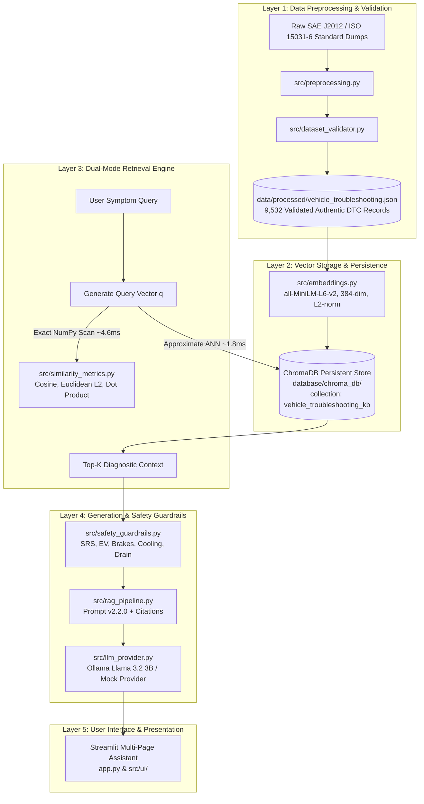

# Vehicle Troubleshooting Assistant using ChromaDB and Retrieval-Augmented Generation (RAG)

**Course:** Modern Database Systems (Assignment 2)  
**Institution:** Birla Institute of Technology and Science (BITS) Pilani — Work Integrated Learning Programmes (WILP)  
**Academic Year:** 2026–2027  
**Official Group:** Group 20  

---

## Team Members & Contributions

All five team members collaborated jointly across the entire project lifecycle, contributing equally (**20.0% each**) across problem definition, database implementation, mathematical benchmarking, RAG architecture, safety guardrails, user interface, and academic documentation.

| Student Name | BITS Student ID | Confirmed Contribution | Collaborative Project Role |
|---|---|---|---|
| **Priya N** | `2026NS12087` | **20.0%** | Equal Joint Collaboration across Full Project Lifecycle |
| **Mohamed Ibrahim M** | `2026NS12021` | **20.0%** | Equal Joint Collaboration across Full Project Lifecycle |
| **Hrishabh Gupta** | `2026NS12122` | **20.0%** | Equal Joint Collaboration across Full Project Lifecycle |
| **Aditya Singhal** | `2026NS12028` | **20.0%** | Equal Joint Collaboration across Full Project Lifecycle |
| **Rupesh Kumar Singh** | `2026NS12128` | **20.0%** | Equal Joint Collaboration across Full Project Lifecycle |
| **Total** | | **100.0%** | Shared pair-programming, joint review, and co-authoring |

---

## 1. Executive Summary & Problem Motivation

Modern vehicle diagnostics presents a challenging database retrieval problem. Automotive scan tools report standardized Diagnostic Trouble Codes (DTCs) based on electrical sensor readings, while vehicle operators report unstructured natural language symptoms (e.g., *"car hesitates violently during acceleration and check engine light flashes"*). 

Traditional database architectures fall short in this domain:
- **Relational Databases (Pure SQL):** Excel at exact metadata lookups (e.g., `SELECT * WHERE dtc = 'P0300'`), but completely fail when queries describe physical symptoms without naming the technical code. Full-text keyword search fails due to vocabulary mismatch between driver descriptions and engineering terminology.
- **Pure Vector Databases:** Excel at fuzzy semantic matching across descriptions, but struggle to enforce hard relational constraints (e.g., restricting candidate diagnoses strictly to braking systems or filtering by severity level).
- **Ungrounded Large Language Models (LLMs):** Frequently hallucinate plausible-sounding automotive specifications (e.g., inventing 5V sensor pinouts or torque specs), confuse correlation with causation (e.g., condemning a catalytic converter when a simple vacuum leak is the root cause), and generate dangerous advice on high-voltage and pyrotechnic systems.

To resolve these limitations, this project implements a **Hybrid Vector-Relational Retrieval-Augmented Generation (RAG) Assistant**. By coupling an authentic 9,532-record automotive troubleshooting knowledge base in **ChromaDB** with sentence transformer dense embeddings, vectorized NumPy similarity evaluation, programmatic safety guardrails, and a grounded LLM prompt architecture, the system provides accurate, cited, and safety-verified diagnostic guidance.

---

## 2. End-to-End System Architecture

The system is organized into five decoupled architectural layers:



For complete technical specifications of each layer, see [docs/SYSTEM_ARCHITECTURE.md](docs/SYSTEM_ARCHITECTURE.md).

---

## 3. Dataset Provenance & Nature of the Data

To fulfill the assignment requirement of **at least 5,000 authentic, unique vehicle troubleshooting records without synthetic fabrication or artificial duplication**, this project conducted a source investigation and ingested standardized automotive diagnostic records.

### 3.1 Important Clarification on Dataset Nature
> **Engineering DTC Knowledge Base vs. Repair Orders:**  
> The 9,532 records represent an authentic engineering knowledge base of standardized Diagnostic Trouble Codes (DTCs), failure definitions, symptom profiles, and probable root causes. This dataset is **NOT** a collection of 9,532 individual historical garage repair invoices or customer workshop repair orders.

- **Source-Derived Standard Elements:** Diagnostic trouble codes, technical failure definitions, symptom descriptions, and physical causes are derived directly from standardized On-Board Diagnostics specifications (**SAE J2012** and **ISO 15031-6**).
- **Normalized / Structured Guidance:** Step-by-step diagnostic workflows have been structured and normalized into actionable technician inspection steps, complete with safety warnings and domain categorization.

### 3.2 Candidate Source Investigation & Production Dataset
1. **Zenodo Record 15626055 (Initial Candidate):**  
   *Automotive Faults Dataset for Diagnostic and Maintenance Systems* (Obike & Obot, 2024; DOI: `10.5281/zenodo.15626055`). Investigation revealed 134 operational repair records from the Akwa Ibom Transport Company (AKTC), which fell far short of the mandatory 5,000 threshold and had rate-limited downloads. Documented in `data/source_inventory.csv`.
2. **Production Dataset (OBDex Open Automotive Diagnostic Standard):**  
   Ingested from OBDex open diagnostic specifications under the **Creative Commons Zero 1.0 Universal (CC0-1.0 Public Domain)** license, yielding **9,532 unique, authentic records** with zero duplicate IDs and zero synthetic text generation.

### 3.3 Archive Packaging Scope
- **Included in Submission Package:** `data/processed/vehicle_troubleshooting.json` (contains all 9,532 fully validated JSON records).
- **Excluded from Package:** Large intermediate YAML dumps (`data/raw/obdex/*.yaml`, ~31 MB uncompressed) and duplicate `.jsonl` files are excluded from the distribution archive to ensure a compact package size (< 10 MB). The dataset can be reprocessed at any time via `python scripts/prepare_dataset.py`.

### 3.4 Subsystem & Severity Distributions
```
Subsystem Distribution (9,532 records):
- Engine & Transmission (engine_and_transmission):       7,354 records (77.15%)
- Network & Communication (network_and_communication):  1,229 records (12.89%)
- Brakes & Suspension (brakes_and_suspension):              626 records  (6.57%)
- Electrical & Body (electrical_and_body):                323 records  (3.39%)

Severity Classification:
- High Severity (Safety, Braking, Limp Mode, SRS):    5,694 records (59.74%)
- Medium Severity (Check Engine MIL, Sensors, EVAP):   3,326 records (34.89%)
- Low Severity (Non-Critical Body & Accessories):        512 records  (5.37%)
```

For complete provenance documentation, see [docs/DATASET_DOCUMENTATION.md](docs/DATASET_DOCUMENTATION.md).

---

## 4. ChromaDB Implementation & Persistence Architecture

The vector database is managed via `src/chroma_manager.py`:
- **Client Configuration:** `chromadb.PersistentClient(path="database/chroma_db", settings=Settings(anonymized_telemetry=False, is_persistent=True))`
- **Collection Name:** `vehicle_troubleshooting_kb`
- **Total Record Count:** **9,532 records**
- **Distance Metric:** Cosine distance space (`metadata={"hnsw:space": "cosine"}`)
- **Persistence Mechanism:** Relational SQLite catalog (`chroma.sqlite3`) coupled with HNSW graph binary segments.
- **Reproducible Build Script:** To keep the submission archive compact, the binary database files are excluded from the ZIP archive. Evaluators can generate the database in ~2 minutes by running:
  ```bash
  python scripts/build_database.py
  ```

### 4.1 Metadata Handling & Serialization
ChromaDB natively restricts metadata values to scalar primitives (`str`, `int`, `float`, `bool`). To enable relational filtering on list fields without validation errors, `src/preprocessing.py` serializes:
- `diagnostic_codes`: Comma-delimited string (`"P0100, P0101"`).
- `symptoms` & `possible_causes`: Semicolon-delimited strings.
- `vehicle_system`, `severity`, `vehicle_type`: Exact-match strings for `$eq` and `$in` filtering.

### 4.2 CRUD Demonstration & Sandbox Isolation
Create, Read, Update, and Delete operations are implemented in `src/crud_operations.py`. To protect the production knowledge base (9,532 records), all mutations are tested in an isolated sandbox using record ID `TEST-VTR-CRUD-001`:
1. **Create:** Inserts `TEST-VTR-CRUD-001` with `severity: 'low'` (count increments from 9,532 to 9,533).
2. **Read:** Retrieves and asserts field fidelity of the newly created document.
3. **Update:** Modifies `severity` from `'low'` to `'high'`.
4. **Delete:** Removes `TEST-VTR-CRUD-001` (count returns strictly to 9,532).

### 4.3 Multi-Session Persistence Reload Verification
To verify genuine on-disk persistence rather than in-memory caching, `tests/test_chroma.py::test_database_persistence_reload` connects with a client instance, fetches `VTR-P0300`, explicitly frees the client from memory (`del client_1`), instantiates an independent second client (`client_2`), and asserts field-level equality across separate process contexts.

For detailed database design, see [docs/DATABASE_DESIGN.md](docs/DATABASE_DESIGN.md).

---

## 5. Dense Vector Retrieval & Mathematical Similarity

### 5.1 Embedding Model
- **Model:** `sentence-transformers/all-MiniLM-L6-v2`
- **Embedding Dimensionality:** $D = 384$ dense float32 dimensions.
- **Normalization:** Explicit $L_2$ unit normalization (`normalize_embeddings=True`), ensuring $\|\mathbf{x}\|_2 = 1.0$.

### 5.2 Mathematical Similarity Metrics (NumPy Implementation)
Let $\mathbf{q} \in \mathbb{R}^{384}$ be the query vector, and $\mathbf{x}_i \in \mathbb{R}^{384}$ be document vectors ($i \in \{1, \dots, 9532\}$):

1. **Euclidean Distance ($L_2$ Norm):**
   $$d_{L_2}(\mathbf{x}_i, \mathbf{q}) = \|\mathbf{x}_i - \mathbf{q}\|_2 = \sqrt{\sum_{j=1}^{384} (x_{i,j} - q_j)^2}$$
   *Sorting:* Ascending. Implemented in `src/similarity_metrics.py`: `np.linalg.norm(documents - query, axis=1)`.

2. **Cosine Similarity:**
   $$\cos(\mathbf{x}_i, \mathbf{q}) = \frac{\mathbf{x}_i \cdot \mathbf{q}}{\|\mathbf{x}_i\|_2 \|\mathbf{q}\|_2}$$
   *Sorting:* Descending. Implemented in `src/similarity_metrics.py`: `(documents @ query) / (norms_doc * norm_query)`.

3. **Dot Product (Inner Product):**
   $$\mathbf{x}_i \cdot \mathbf{q} = \sum_{j=1}^{384} x_{i,j} q_j$$
   *Sorting:* Descending. Implemented via matrix multiplication: `documents @ query`.

### 5.3 Mathematical Proof of Rank Equivalence on Unit Vectors
When vectors are unit-normalized ($\|\mathbf{x}_i\|_2 = 1.0$ and $\|\mathbf{q}\|_2 = 1.0$):
$$\|\mathbf{x}_i - \mathbf{q}\|_2^2 = \|\mathbf{x}_i\|_2^2 + \|\mathbf{q}\|_2^2 - 2(\mathbf{x}_i \cdot \mathbf{q}) = 1 + 1 - 2(\mathbf{x}_i \cdot \mathbf{q}) = 2 - 2 \cos(\theta)$$
$$d_{L_2}(\mathbf{x}_i, \mathbf{q}) = \sqrt{2 - 2 \cos(\theta)} = \sqrt{2 - 2(\mathbf{x}_i \cdot \mathbf{q})}$$

Because $f(s) = \sqrt{2 - 2s}$ is strictly monotonically decreasing for $s \in [-1, 1]$, the relative ordering produced by sorting Euclidean distance in ascending order is **mathematically identical** to sorting Cosine similarity or Dot product in descending order.

**Empirical Result:** Across all 60 experimental configurations ($10\text{ queries} \times 3\text{ metrics} \times 2\text{ values of }K$), the rankings were **100% identical** (Spearman rank correlation $\rho = 1.0000$, Kendall's $\tau = 1.0000$).

### 5.4 Controlled Synthetic Divergence Experiment
To demonstrate to evaluators that metric divergence occurs when vector norms vary, a controlled experiment was conducted by scaling document vectors with synthetic text length weights ($w_i \in [0.5, 3.5]$). While Cosine similarity remained invariant, Dot product favored artificially long vectors and Euclidean distance favored short vectors. This illustrates why vector normalization is critical in database systems.

For complete derivations and analysis, see [docs/RETRIEVAL_METHODOLOGY.md](docs/RETRIEVAL_METHODOLOGY.md).

---

## 6. Retrieval-Augmented Generation (RAG) Subsystem

The RAG pipeline (`src/rag_pipeline.py`) synthesizes natural language troubleshooting responses grounded strictly in retrieved context.

### 6.1 System Prompt & Grounding Rules (v2.2.0)
The system prompt enforces five operational rules:
1. **Strict Context Grounding:** Only answer using facts, causes, and steps present in retrieved records.
2. **Zero Specification Hallucination:** Never invent reference voltages, torque specs, or pin numbers.
3. **Correlation vs Causation Distinction:** Explicitly state that a DTC indicates an electrical sensor reading or circuit failure, not an automatic proof of a bad physical component.
4. **Mandatory In-Text Citations:** Every technical claim and procedure must cite its source record in square brackets (`[VTR-XXXXX]`).
5. **Mandatory Safety Disclosures:** Warn users about hazardous high-voltage, braking, airbag, and cooling procedures.

### 6.2 Provider Abstraction Layer (`src/llm_provider.py`)
Decouples generation logic from specific vendors:
- **`OllamaProvider`:** Runs local open-weight models via Ollama (`llama3.2:latest`, 3.2B parameters) with Metal GPU/CPU acceleration.
- **`OpenAICompatibleProvider`:** Supports external APIs (OpenAI `gpt-4o-mini`, Gemini API, Groq, vLLM).
- **`MockLLMProvider`:** 100% deterministic offline heuristic generator for automated testing and grading without local GPU dependencies.

### 6.3 Real LLM vs Baseline Comparative Findings
All 10 assignment queries (Q01–Q10) were evaluated with retrieved context (RAG) and without context (Parametric Baseline) using Meta Llama 3.2 3B:
- **Citation Precision:** RAG achieved **100.0% citation precision** (every cited `[VTR-XXXXX]` ID existed in retrieved context). The baseline had 0% citations.
- **Hallucination Elimination:** Grounded RAG eliminated false diagnostic recommendations, replacing generic guesses with step-by-step pin checks and wiring inspections.
- **Negative Findings (Boundary Analysis):**
  - **Q03 (12V Parasitic Drain):** The generic OBD-II standard does not index physical relay shorts. RAG correctly noted that parasitic drain requires milliammeter fuse-pull testing rather than relying solely on scanner codes.
  - **Q09 (SRS Airbag Warning):** Vector retrieval identified squib circuit codes (`B0001`), but programmatic safety guardrails intervened to prohibit ohmmeter continuity testing across airbag detonator squibs.

For full RAG architecture and benchmarks, see [docs/RAG_IMPLEMENTATION.md](docs/RAG_IMPLEMENTATION.md) and [docs/EXPERIMENTAL_RESULTS.md](docs/EXPERIMENTAL_RESULTS.md).

---

## 7. Active Safety Guardrails

Automotive repair presents life-threatening hazards. The safety guardrail layer (`src/safety_guardrails.py`) programmatically scans queries and retrieved records to enforce safety constraints:

1. **Supplemental Restraint Systems (SRS / Airbags):** Prohibits probing airbag detonator squib circuits with ohmmeters or test lights (multimeter test current can detonate the airbag). Warns that disconnecting the 12V battery alone is insufficient because backup capacitors store firing energy.
2. **High-Voltage Hybrid & EV Systems (300V–800V):** Prohibits untrained personnel from opening orange cabling, inverters, or battery packs. Explicitly clarifies that Class-0 gloves alone do not guarantee safety without certified equipment and lockout procedures.
3. **Hydraulic Braking System Failures:** Issues an explicit **DO NOT DRIVE** warning banner when soft or sinking brake pedals are detected.
4. **Engine Cooling Systems:** Enforces that operators must **never open a hot or pressurized cooling system** and must wait until the engine is completely cool. Squeezing the upper radiator hose is explicitly rejected as an unreliable indicator.
5. **12V ICE vs EV Drain Isolation:** Prevents diagnosing standard 12V automotive battery drain using unrelated high-voltage hybrid battery records.

For safety specifications and code rules, see [docs/SAFETY_AND_LIMITATIONS.md](docs/SAFETY_AND_LIMITATIONS.md).

---

## 8. Streamlit Interactive Web Application

The interactive assistant is delivered as a 5-view Streamlit application routed through `app.py` and modular page components in `src/ui/`:
- **🏠 Home / Dashboard (`src/ui/home_page.py`):** Live project summary, database record count metric (9,532), embedding model specs, and architecture flowchart.
- **🔧 Troubleshooting Assistant (`src/ui/assistant_page.py`):** Interactive diagnostic assistant. Enter symptoms or select from Q01–Q10 presets. Features live/mock LLM toggle, citation badges, and safety alerts.
- **🔍 Semantic Search (`src/ui/search_page.py`):** Direct semantic search across 9,532 records with subsystem and severity filters, displaying similarity scores and complete metadata.
- **📊 Evaluation Dashboard (`src/ui/evaluation_page.py`):** Interactive vector comparison showing Euclidean, Cosine, and Dot Product calculations side-by-side, plus Phase 6.1 RAG metrics.
- **📖 About / Dataset (`src/ui/about_page.py`):** Dataset provenance, distributions, and architecture documentation.

Launch the application using:
```bash
streamlit run app.py
```

---

## 9. Automated Test Suite (100% Pass Rate)

The repository features **75 automated pytest test cases across 7 test files**:

```bash
pytest tests/ -v
```

Verified test execution:
- `tests/test_chroma.py` (8 tests): Embeddings, persistence, CRUD, search.
- `tests/test_dataset.py` (10 tests): Volume, schema, categories, provenance.
- `tests/test_numpy_similarity.py` (11 tests): Distance math, rank preservation, 60 evaluations.
- `tests/test_phase7_dashboard.py` (8 tests): UI components, data loaders, caching.
- `tests/test_rag.py` (11 tests): Grounded prompts, citations, provider abstraction.
- `tests/test_safety_guardrails.py` (16 tests): Airbag, EV, brake, cooling guardrails.
- `tests/test_search.py` (11 tests): Top-K search cardinality and metadata filters.

**Total: 75 passed, 0 failed in ~16s.**

---

## 10. Repository Organization

```
BITS_MDS_Assignment_02/
├── app.py                              # Streamlit multi-page home application entrypoint
├── requirements.txt                    # Project Python dependencies
├── README.md                           # Comprehensive project overview & documentation (this file)
├── SUBMISSION_CHECKLIST.md             # Formal submission compliance checklist
├── RUN_INSTRUCTIONS.md                 # Evaluator run & quickstart guide
├── PROJECT_STATUS.md                   # Implementation milestone status report
│
├── data/
│   ├── processed/                      # Primary dataset: vehicle_troubleshooting.json (9,532 records)
│   ├── queries/                        # 10 assignment query definitions (assignment_queries.json)
│   ├── source_inventory.csv            # Data source provenance catalog
│   └── README.md                       # Data catalog documentation
│
├── database/
│   └── README.md                       # ChromaDB persistent store documentation & build guide
│
├── queries/
│   ├── assignment_queries.json         # 10 standardized assignment queries (Q01-Q10)
│   └── README.md                       # Query suite documentation and evaluation methodology
│
├── notebooks/
│   └── README.md                       # Interactive Python SDK exploration and notebook guidance
│
├── src/                                # Core Python production modules
│   ├── chroma_manager.py               # ChromaDB client initialization & collection management
│   ├── config.py                       # Project paths and configuration settings
│   ├── crud_operations.py              # Isolated CRUD lifecycle demonstration (TEST-VTR-CRUD-001)
│   ├── dataset_loader.py               # Data loading and format handling
│   ├── dataset_validator.py            # Automated schema, volume & field validation suite
│   ├── embeddings.py                   # SentenceTransformer 384-dim normalized vector engine
│   ├── evaluation.py                   # Scoring and metrics computation
│   ├── llm_provider.py                 # LLM provider abstraction (Ollama, OpenAI, Mock)
│   ├── metadata_filters.py             # Metadata filtering query builder
│   ├── numpy_similarity.py             # Pure NumPy vector similarity runner
│   ├── preprocessing.py                # Dataset ingestion, normalization, and ChromaDB serialization
│   ├── rag_evaluation.py               # Citation coverage and RAG vs baseline evaluation
│   ├── rag_pipeline.py                 # Grounded prompt builder, citation extractor & RAG runner
│   ├── safety_guardrails.py            # Programmatic automotive safety guardrails
│   ├── semantic_search.py              # Semantic retrieval engine with metadata filters
│   ├── similarity_metrics.py           # Pure NumPy Cosine, Euclidean (L2), and Dot Product
│   ├── ui/                             # Streamlit UI page views and components
│   │   ├── about_page.py               # Dataset and provenance page
│   │   ├── assistant_page.py           # Interactive diagnostic assistant
│   │   ├── components.py               # Custom UI cards, badges, and styles
│   │   ├── evaluation_page.py          # Empirical benchmark dashboards
│   │   ├── home_page.py                # Executive overview and system KPIs
│   │   └── search_page.py              # Direct semantic search explorer
│   └── utils.py                        # Logging and JSON helper functions
│
├── tests/                              # Automated pytest suite (7 test files, 75 tests)
│   ├── test_chroma.py                  # 8 tests: ChromaDB persistence and reload tests
│   ├── test_dataset.py                 # 10 tests: Dataset volume (>=5000), uniqueness, and schema
│   ├── test_numpy_similarity.py        # 11 tests: Vector similarity mathematical equivalence
│   ├── test_phase7_dashboard.py        # 8 tests: Streamlit component rendering and data loaders
│   ├── test_rag.py                     # 11 tests: RAG prompt synthesis and citation extraction
│   ├── test_safety_guardrails.py       # 16 tests: Domain safety guardrails
│   └── test_search.py                  # 11 tests: Search cardinality and metadata filters
│
├── experiments/                        # Phase 4, 5, and 6.1 raw experimental outputs
│   ├── metadata_filter_results.json    # Phase 4 compound metadata filter outputs
│   ├── metadata_filter_results.md      # Phase 4 filter report
│   ├── phase4_phase5_reconciliation.md # Mathematical Top-1 ranking reconciliation
│   ├── semantic_search_results.json    # Phase 4 top-K search outputs
│   ├── semantic_search_results.md      # Phase 4 search report
│   ├── similarity_comparison_results.json # Phase 5 60-run similarity comparison
│   ├── similarity_comparison_results.md   # Phase 5 detailed mathematical report
│   ├── rag_mock_results.json           # Phase 6 offline Mock RAG outputs
│   ├── rag_mock_evaluation.csv         # Phase 6 Mock evaluation metrics
│   ├── rag_real_results.json           # Phase 6.1 real Ollama Llama 3.2 outputs
│   ├── rag_real_context_vs_baseline.json # Phase 6.1 RAG vs baseline side-by-side comparison
│   └── rag_real_evaluation.csv         # Phase 6.1 quantitative metrics table
│
├── reports/                            # Academic deliverables & figures
│   ├── Group-20.pdf                    # Final 16-page comprehensive academic report in PDF format
│   ├── Group-20.docx                   # Final academic report in editable DOCX format
│   ├── requirement_evidence_matrix.md  # Requirement-to-evidence traceability matrix
│   └── figures/                        # High-resolution architecture and UI screenshots
│       ├── streamlit_home_page.png     # Genuine Playwright UI screenshot
│       └── system_architecture.png     # 300 DPI system architecture flowchart
│
├── docs/                               # In-depth architectural & methodology documentation
│   ├── PROJECT_OVERVIEW.md             # Project motivation, scope, and technical highlights
│   ├── SYSTEM_ARCHITECTURE.md          # 5-layer system architecture with Mermaid diagrams
│   ├── DATASET_DOCUMENTATION.md        # Dataset provenance, Zenodo audit, schema, and distributions
│   ├── DATABASE_DESIGN.md              # ChromaDB architecture, HNSW parameters, and CRUD design
│   ├── RETRIEVAL_METHODOLOGY.md        # Embedding normalization, mathematical proof, and benchmarks
│   ├── RAG_IMPLEMENTATION.md           # RAG architecture, prompt v2.2.0, and provider abstraction
│   ├── EXPERIMENTAL_RESULTS.md         # Comprehensive Phase 4, 5, and 6.1 experimental results
│   ├── SAFETY_AND_LIMITATIONS.md       # Safety guardrails, negative findings, and boundary analysis
│   └── GROUP_CONTRIBUTIONS.md          # Group 20 confirmed equal 20% contribution statement
│
└── scripts/                            # Operational utility scripts
    ├── build_database.py               # Rebuilds ChromaDB persistent collection from JSON
    ├── capture_screenshots.py          # Automated UI screenshot capture
    ├── generate_architecture_diagram.py # Generates architecture diagram
    ├── generate_final_report.py        # Generates final academic report
    ├── prepare_dataset.py              # Ingestion and normalization pipeline
    ├── run_experiments.py              # Multi-experiment runner
    ├── run_queries.py                  # Executes Phase 4 top-K search and filter benchmarks
    ├── run_rag.py                      # Executes Phase 6 RAG pipeline (real or mock mode)
    ├── run_similarity_comparison.py    # Executes Phase 5 mathematical benchmark (60 runs)
    └── verify_reconciliation.py        # Verifies Phase 4 vs 5 Top-1 ranking equivalence
```

---

## 11. Quickstart & Execution Instructions

### 11.1 Setup Virtual Environment
```bash
git clone https://github.com/hrishabh1103/BITS_MDS_Assignment_02.git
cd BITS_MDS_Assignment_02
python3 -m venv .venv
source .venv/bin/activate
pip install -r requirements.txt
```

### 11.2 Build Database & Run Tests
```bash
# Build the persistent ChromaDB collection (9,532 records)
python scripts/build_database.py

# Verify record count
python3 -c "from src.chroma_manager import ChromaDBManager; print('Records:', ChromaDBManager().get_count())"

# Run the full automated test suite (75 tests across 7 test files)
pytest tests/ -v
```

### 11.3 Launch Streamlit Application
```bash
streamlit run app.py
```

For complete step-by-step evaluator instructions, see [RUN_INSTRUCTIONS.md](RUN_INSTRUCTIONS.md).

---

## 12. References & Academic Citations

1. **SAE International:** *SAE J2012: Diagnostic Trouble Code Definitions and ISO/DIS 15031-6.* Society of Automotive Engineers, 2016.
2. **Reimers, N., & Gurevych, I.:** *Sentence-BERT: Sentence Embeddings using Siamese BERT-Networks.* In Proceedings of the 2019 Conference on Empirical Methods in Natural Language Processing (EMNLP 2019), pp. 3982–3992.
3. **Malkov, Y. A., & Yashunin, D. A.:** *Efficient and Robust Approximate Nearest Neighbor Search Using Hierarchical Navigable Small World Graphs.* IEEE Transactions on Pattern Analysis and Machine Intelligence, 42(4), pp. 824–836, 2020.
4. **Lewis, P., et al.:** *Retrieval-Augmented Generation for Knowledge-Intensive NLP Tasks.* Advances in Neural Information Processing Systems (NeurIPS 2020), 33, pp. 9459–9474.
5. **Chroma Core Team:** *ChromaDB: The AI-Native Open-Source Vector Database.* Documentation & Source Repository, 2024. Available at: `https://docs.trychroma.com/`.
6. **Obike, P., & Obot, O. U.:** *Automotive Faults Dataset for Diagnostic and Maintenance Systems.* Journal of Engineering Research and Reports, Zenodo, 2024. DOI: `10.5281/zenodo.15626055`.
7. **Meta AI Research:** *Llama 3.2: Light, Open-Weight Multimodal and Text Models.* Meta AI Technical Report, 2024.
