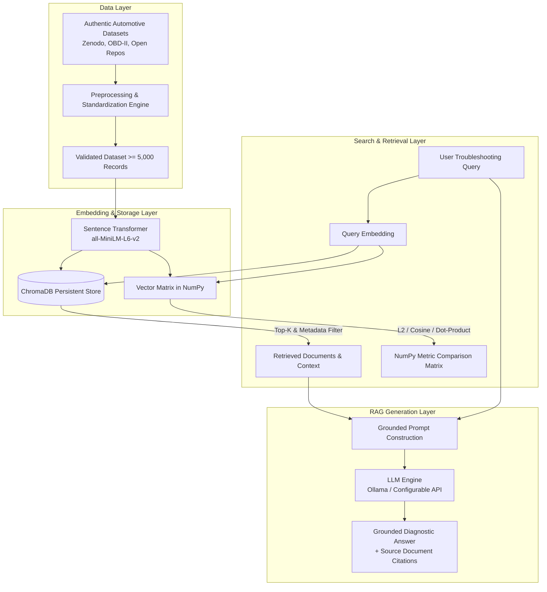

# Vehicle Troubleshooting Assistant using ChromaDB and Retrieval-Augmented Generation (RAG)

**BITS Pilani WILP – Modern Database Systems (Assignment 2)**

---

## Overview

The **Vehicle Troubleshooting Assistant** is an end-to-end vector database and generative AI retrieval system designed to assist technicians, researchers, and vehicle owners in diagnosing automotive faults. It leverages **ChromaDB** for persistent vector storage and metadata querying, **Sentence Transformers** (`all-MiniLM-L6-v2`) for semantic vector embeddings, **NumPy** for comparative mathematical evaluation of vector similarity metrics, and an extensible **Retrieval-Augmented Generation (RAG)** pipeline powered by local LLMs (Ollama) or external APIs.

> **Academic & Safety Disclaimer**:  
> This system is built strictly for academic demonstration and general automotive knowledge retrieval. AI-generated diagnostic advice does not replace certified professional vehicle inspection and maintenance.

---

## Core System Architecture



---

## Project Structure

```
├── app.py                      # Streamlit interactive application
├── requirements.txt            # Python dependencies
├── README.md                   # Project overview & documentation
├── .gitignore                  # Git ignore rules
├── .env.example                # Sample environment configuration
│
├── data/
│   ├── raw/                    # Raw source datasets
│   ├── processed/              # Cleaned, standardized JSON/Parquet records
│   ├── queries/                # 10 assignment query definitions
│   └── README.md
│
├── database/
│   └── chroma_db/              # Persistent ChromaDB storage directory
│
├── src/
│   ├── config.py               # Central configuration settings
│   ├── dataset_loader.py       # Data source fetching & raw ingestion
│   ├── preprocessing.py        # Normalization, schema mapping & deduplication
│   ├── dataset_validator.py    # Schema & volume validation engine
│   ├── embeddings.py           # Text embedding generator
│   ├── chroma_manager.py       # ChromaDB persistent collection & CRUD
│   ├── semantic_search.py      # Semantic retrieval engine
│   ├── metadata_filters.py     # Filter construction & validation
│   ├── crud_operations.py      # Isolated database CRUD operations
│   ├── numpy_similarity.py     # Exhaustive Euclidean, Cosine & Dot Product
│   ├── experiment_runner.py    # Automated query benchmark runner
│   ├── rag_pipeline.py         # Prompt builder & context-grounded RAG
│   ├── llm_provider.py         # Ollama / API abstraction layer
│   ├── rag_evaluation.py       # RAG evaluation & baseline comparative metrics
│   └── utils.py                # Logging & file helper utilities
│
├── experiments/
│   ├── results/                # Consolidated benchmark outputs
│   ├── query_results/          # Detailed retrieval dumps
│   ├── metric_comparison/      # NumPy vs ChromaDB comparison data
│   └── rag_evaluation/         # Context vs No-Context comparison dumps
│
├── tests/                      # Automated pytest suite
│   ├── test_dataset.py
│   ├── test_chroma.py
│   ├── test_search.py
│   ├── test_numpy_similarity.py
│   └── test_rag.py
│
├── docs/                       # Academic documentation & viva prep
│   ├── architecture.md
│   ├── dataset_documentation.md
│   ├── embedding_model.md
│   ├── experiments.md
│   ├── results_analysis.md
│   ├── limitations.md
│   ├── implementation_checklist.md
│   ├── report_draft.md
│   └── viva_questions.md
│
└── scripts/                    # Reproducible command-line entry points
    ├── prepare_dataset.py
    ├── build_database.py
    ├── run_queries.py
    ├── run_experiments.py
    ├── run_rag.py
    └── validate_project.py
```

---

## Quickstart & Setup

### 1. Environment Setup

```bash
# Clone or enter workspace
cd BITS_MDS_Assignment_02

# Create and activate virtual environment (Python 3.11 recommended)
python3.11 -m venv .venv
source .venv/bin/activate

# Install dependencies
pip install -r requirements.txt

# Configure environment variables (optional; defaults to local Ollama)
cp .env.example .env
```

### 2. Ollama Local LLM Setup (Optional for Live Inference)

The application supports both offline Mock mode (for CI/grading) and live real inference via Ollama:

```bash
# Install and start Ollama (macOS / Linux)
# Pull the recommended lightweight 3.2B parameter model
ollama pull llama3.2

# Verify installation
ollama list
# Output should list: llama3.2:latest (2.0 GB)
```

### 3. Launching the Streamlit Application (Phase 7)

```bash
# Launch the multi-page application
streamlit run app.py
```
Open your browser at `http://localhost:8501`.

---

## Streamlit Application Pages (Phase 7)

The application provides a 5-page analytical interface:

1. **🏠 Home / Dashboard (`src/ui/home_page.py`)**:
   - Executive metrics: 9,532 indexed records, 384 embedding dims, active Ollama LLM status, 10 assignment benchmark queries.
   - Project objective and anti-hallucination motivation.
   - Overview of the 5 backend automotive safety guardrails.
   - Interactive RAG workflow architecture diagram.

2. **🔧 Troubleshooting Assistant (`src/ui/assistant_page.py`)**:
   - Natural language driver symptom input with one-click benchmark preset buttons (Q01, Q03, Q04, Q09, Q10).
   - Vehicle powertrain selector (`ICE`, `Hybrid`, `EV`, `Unknown`) and optional make/model/year metadata.
   - Tunable retrieval cutoff ($K$: 1–10) and configurable max output tokens (512–2048).
   - Prominent automotive safety alert banners (SRS squib hazards, 400V EV loops, sinking brake pedals).
   - Domain mismatch notice (e.g. 12V ICE alternator drain vs. EV charger codes).
   - Grounded diagnostic answer with verified `[VTR-XXXXX]` source record badges and truncation warnings.
   - Expandable retrieved diagnostic knowledge cards with Cosine distances and similarity scores.

3. **🔍 Semantic Search Explorer (`src/ui/search_page.py`)**:
   - Direct dense vector retrieval over 9,532 ChromaDB records.
   - Compound metadata filtering ($and logic across `vehicle_system` and `severity`).
   - Card view vs. interactive tabular dataframe view with distance ordering.

4. **📊 Evaluation Dashboard (`src/ui/evaluation_page.py`)**:
   - **Tab 1**: Phase 6.1 Real RAG vs. Baseline benchmark table (Q01–Q10) with side-by-side response inspector.
   - **Tab 2**: Citation Fidelity & Anti-Hallucination analysis (Precision: 100%, Recall: 96%; reference provenance vs. factual truth).
   - **Tab 3**: Phase 5 NumPy exhaustive metric comparisons (Euclidean L2 vs. Cosine vs. Dot Product; exact linear scan vs. HNSW).
   - **Tab 4**: Phase 4 dense retrieval top-K benchmark distributions and filter tests.

5. **📖 About & Dataset Provenance (`src/ui/about_page.py`)**:
   - Zenodo (`15626055`) and OBDex knowledge base provenance under CC0 1.0 Public Domain license.
   - Record distribution tables and interactive bar charts across subsystems and severity tiers.
   - Full-stack technical architecture diagram.
   - Correlation vs. causation boundaries in OBD-II diagnostics.

---

## Backend Automotive Safety Guardrails (`src/safety_guardrails.py`)

1. **Supplemental Restraint Systems (SRS / Airbag)**:
   - Targeted detection of airbag, clock spring, and squib queries (does NOT trigger on generic B-codes).
   - Forbids ohmmeter / multimeter resistance checks across squib terminals (meter current triggers pyrotechnic detonation).
2. **High-Voltage Hybrid/EV Loops**:
   - Warns against touching orange 300V–800V cables or opening battery enclosures without Class-0 PPE.
3. **ICE 12V Battery Drain vs. EV Charger Mismatch**:
   - Detects when ordinary 12V alternator drains retrieve hybrid/EV high-voltage charger codes, preventing false EV diagnostics.
4. **Hydraulic Braking System Safety**:
   - Detects sinking/soft brake pedals, classifies vehicle as UNSAFE TO DRIVE, and mandates immediate towing.
5. **Thermal Cooling Scald Hazards**:
   - Warns never to open a hot pressurized radiator or reservoir cap due to explosive steam and burn risks.

---

## Running the Automated Test Suite

```bash
# Run all 68 automated unit, integration, and safety tests
PYTHONPATH=. .venv/bin/pytest tests/ -v
```

---

## Known System Limitations

1. **Reference Provenance vs. Factual Truth**: Citation Precision measures whether cited IDs exist in the retrieved context set (guarding against hallucinated IDs). It does not evaluate mechanical correctness.
2. **Correlation vs. Causation**: A Diagnostic Trouble Code indicates that an electrical sensor or rational parameter is out of threshold; it does not definitively prove the component has physically failed.
3. **Token Limit Headroom**: Complex multi-system queries can exceed tight token caps; the assistant provides a configurable slider (up to 2,048 tokens) and surfaces explicit truncation notices.
