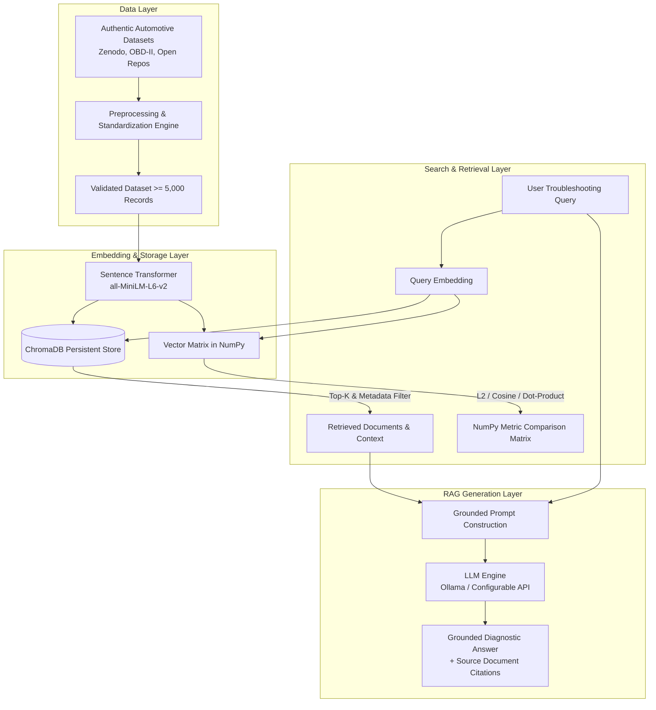

# Vehicle Troubleshooting Assistant using ChromaDB and Retrieval-Augmented Generation (RAG)

**BITS Pilani WILP – Modern Database Systems (Assignment 2)**

---

## Overview

The **Vehicle Troubleshooting Assistant** is an end-to-end vector database and generative AI retrieval system designed to assist technicians, researchers, and vehicle owners in diagnosing automotive faults. It leverages **ChromaDB** for persistent vector storage and metadata querying, **Sentence Transformers** (`all-MiniLM-L6-v2`) for semantic vector embeddings, **NumPy** for comparative mathematical evaluation of vector similarity metrics, and an extensible **Retrieval-Augmented Generation (RAG)** pipeline powered by local LLMs (Ollama) or external APIs.

> **Academic & Safety Disclaimer**:  
> This system is built strictly for academic demonstration and general automotive knowledge retrieval. AI-generated diagnostic advice does not replace certified professional vehicle inspection and maintenance.

---

## Core System Architecture



---

## Project Structure

```
├── app.py                      # Streamlit interactive application
├── requirements.txt            # Python dependencies
├── README.md                   # Project overview & documentation
├── .gitignore                  # Git ignore rules
├── .env.example                # Sample environment configuration
│
├── data/
│   ├── raw/                    # Raw source datasets
│   ├── processed/              # Cleaned, standardized JSON/Parquet records
│   ├── queries/                # 10 assignment query definitions
│   └── README.md
│
├── database/
│   └── chroma_db/              # Persistent ChromaDB storage directory
│
├── src/
│   ├── config.py               # Central configuration settings
│   ├── dataset_loader.py       # Data source fetching & raw ingestion
│   ├── preprocessing.py        # Normalization, schema mapping & deduplication
│   ├── dataset_validator.py    # Schema & volume validation engine
│   ├── embeddings.py           # Text embedding generator
│   ├── chroma_manager.py       # ChromaDB persistent collection & CRUD
│   ├── semantic_search.py      # Semantic retrieval engine
│   ├── metadata_filters.py     # Filter construction & validation
│   ├── crud_operations.py      # Isolated database CRUD operations
│   ├── numpy_similarity.py     # Exhaustive Euclidean, Cosine & Dot Product
│   ├── experiment_runner.py    # Automated query benchmark runner
│   ├── rag_pipeline.py         # Prompt builder & context-grounded RAG
│   ├── llm_provider.py         # Ollama / API abstraction layer
│   ├── rag_evaluation.py       # RAG evaluation & baseline comparative metrics
│   └── utils.py                # Logging & file helper utilities
│
├── experiments/
│   ├── results/                # Consolidated benchmark outputs
│   ├── query_results/          # Detailed retrieval dumps
│   ├── metric_comparison/      # NumPy vs ChromaDB comparison data
│   └── rag_evaluation/         # Context vs No-Context comparison dumps
│
├── tests/                      # Automated pytest suite
│   ├── test_dataset.py
│   ├── test_chroma.py
│   ├── test_search.py
│   ├── test_numpy_similarity.py
│   └── test_rag.py
│
├── docs/                       # Academic documentation & viva prep
│   ├── architecture.md
│   ├── dataset_documentation.md
│   ├── embedding_model.md
│   ├── experiments.md
│   ├── results_analysis.md
│   ├── limitations.md
│   ├── implementation_checklist.md
│   ├── report_draft.md
│   └── viva_questions.md
│
└── scripts/                    # Reproducible command-line entry points
    ├── prepare_dataset.py
    ├── build_database.py
    ├── run_queries.py
    ├── run_experiments.py
    ├── run_rag.py
    └── validate_project.py
```

---

## Quickstart & Setup

### 1. Environment Setup

```bash
# Clone or enter workspace
cd BITS_MDS_Assignment_02

# Create virtual environment (Python 3.11 recommended)
python3.11 -m venv .venv
source .venv/bin/activate

# Install dependencies
pip install -r requirements.txt

# Copy environment configuration
cp .env.example .env
```

### 2. Execution Pipeline

```bash
# Step 1: Ingest, preprocess, and validate dataset (>= 5,000 records)
python scripts/prepare_dataset.py

# Step 2: Build ChromaDB persistent index & embeddings
python scripts/build_database.py

# Step 3: Run semantic queries and metadata tests
python scripts/run_queries.py

# Step 4: Run exhaustive NumPy similarity comparison (Euclidean, Cosine, Dot)
python scripts/run_similarity_comparison.py
# (or: python scripts/run_experiments.py)

# Step 5: Execute RAG evaluation & Context vs No-Context benchmarks
python scripts/run_rag.py

# Step 6: Validate the entire project against assignment rubrics
python scripts/validate_project.py

# Step 7: Launch Streamlit Application
streamlit run app.py
```

---

## Assignment Features

- **Authenticated Dataset**: Strict volume requirement ($\ge 5,000$ unique automotive records) with verifiable provenance.
- **Local Persistent Vector Store**: ChromaDB database persisted to disk with verified reload and isolated CRUD testing.
- **Exhaustive Mathematical Similarity**: Rigorous NumPy computation of Euclidean ($L_2$), Cosine similarity, and Dot-Product across all records for $K=5$ and $K=10$.
- **Retrieval-Augmented Generation (RAG)**: Context-grounded LLM generation with verbatim document citations and side-by-side Context vs. No-Context comparisons.
- **Interactive UI**: Streamlit 7-page analytical dashboard.
