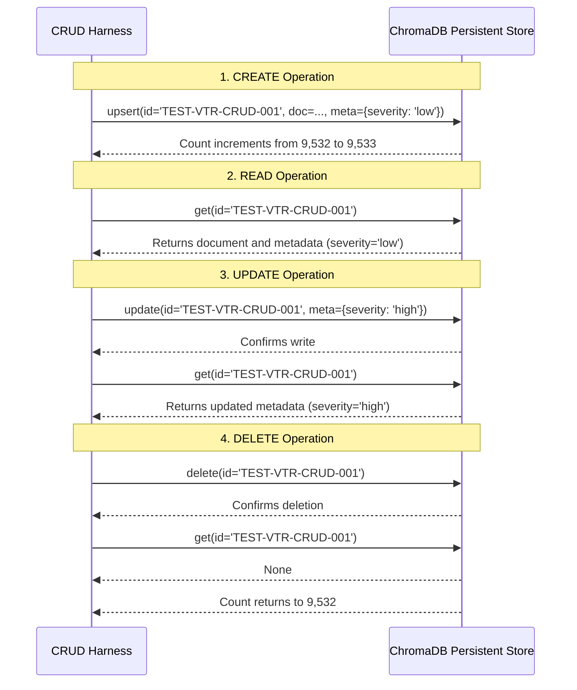

# Database Design & Persistent Architecture

**Course:** BITS Pilani WILP – Modern Database Systems (Assignment 2)  
**Project:** Vehicle Troubleshooting Assistant using ChromaDB and Retrieval-Augmented Generation (RAG)  
**Group:** 20  
**Team Members:**
- Priya N (BITS ID: 2026NS12087) — 20% Contribution
- Mohamed Ibrahim M (BITS ID: 2026NS12021) — 20% Contribution
- Hrishabh Gupta (BITS ID: 2026NS12122) — 20% Contribution
- Aditya Singhal (BITS ID: 2026NS12028) — 20% Contribution
- Rupesh Kumar Singh (BITS ID: 2026NS12128) — 20% Contribution

**Database Engine:** ChromaDB (`>=0.5.0`, local persistent client)  
**Database Root:** `database/chroma_db/`  
**Primary Collection:** `vehicle_troubleshooting_kb`  
**Embedding Model:** `all-MiniLM-L6-v2` (384-dimensional dense vectors)  
**Distance Metric:** Cosine Distance (`{"hnsw:space": "cosine"}`)  
**Total Records:** 9,532 authentic automotive diagnostic records  

---

## 1. Executive Summary & Design Rationale

Modern diagnostic systems require both structured relational filtering (e.g., filtering by vehicle subsystem, severity, or DTC code) and unstructured semantic similarity search (e.g., matching free-text symptoms such as "engine sputtering at idle with blue smoke" to technical diagnostic procedures). 

Traditional relational databases (such as pure PostgreSQL or MySQL without vector extensions) struggle with vocabulary mismatch and approximate semantic search over automotive narratives. ChromaDB was chosen as the specialized vector database engine because:
1. It provides an embedded, local persistent client (`chromadb.PersistentClient`) requiring no external server process or cloud daemon.
2. It natively couples SQLite relational catalog storage (`chroma.sqlite3`) for metadata management with a C++ Hierarchical Navigable Small World (HNSW) graph implementation for sub-millisecond approximate nearest neighbor (ANN) retrieval.
3. It integrates cleanly with standard Python machine learning runtimes (`sentence-transformers`, `numpy`, `torch`).

---

## 2. Persistent Storage Architecture

ChromaDB is configured as a persistent, on-disk vector database storing both the SQLite relational metadata catalog (`chroma.sqlite3`) and the HNSW binary vector index partitions.

```
database/chroma_db/
├── chroma.sqlite3                              # Metadata store, collection schemas, document text (approx. 180 MB)
└── 1930e840-1b41-4045-a696-3599487e00b4/       # HNSW vector graph binary index segment
    ├── data_level0.bin                         # Base graph level storing 384-dim vector points
    ├── header.bin                              # HNSW index hyperparameters and entry point
    ├── hex_ids.bin                             # Document ID string-to-integer mapping
    └── link_list.bin                           # Graph adjacency lists connecting nearest neighbors
```

### 2.1 Client Initialization & Space Configuration
The database client is initialized via `src/chroma_manager.py`:

```python
client = chromadb.PersistentClient(
    path="database/chroma_db",
    settings=Settings(anonymized_telemetry=False, is_persistent=True)
)
collection = client.get_or_create_collection(
    name="vehicle_troubleshooting_kb",
    embedding_function=ChromaEmbeddingAdapter(embedding_manager),
    metadata={"hnsw:space": "cosine"}
)
```

By explicitly declaring `metadata={"hnsw:space": "cosine"}`, ChromaDB constructs an HNSW graph optimized for cosine distance:
$$d_{\text{cosine}}(u, v) = 1 - \frac{u \cdot v}{\|u\|_2 \|v\|_2}$$
Because our embedding pipeline pre-normalizes all document vectors to unit length ($\|u\|_2 = 1$), cosine distance is mathematically equivalent to $1 - u \cdot v$, enabling rapid computation.

---

## 3. Metadata Handling & Type Serialization Strategy

ChromaDB metadata attributes natively restrict values to primitive scalar types: `str`, `int`, `float`, and `bool`. Attempting to store complex nested types (such as `list` or `dict`) raises validation errors in ChromaDB.

### 3.1 Serialization Mapping
To enable both expressive metadata filtering and schema integrity, list-valued fields from `vehicle_troubleshooting.json` are serialized deterministically during ingestion (`format_metadata_for_chroma` in `src/preprocessing.py`):

| Original Schema Field | Original Type | ChromaDB Metadata Representation | Filtering Capability |
|---|---|---|---|
| `vehicle_system` | `str` | `str` (e.g., `"engine_and_transmission"`) | Exact match filtering (`$eq`, `$in`) |
| `severity` | `str` | `str` (e.g., `"high"`, `"medium"`, `"low"`) | Exact match filtering (`$eq`, `$ne`) |
| `vehicle_type` | `str` | `str` (`"passenger_car_and_light_truck"`) | Exact match filtering (`$eq`) |
| `diagnostic_codes` | `List[str]` | Comma-delimited `str` (`"P0100, P0101"`) | String search / substring filter |
| `symptoms` | `List[str]` | Semicolon-delimited `str` | Text inspection / document search |
| `possible_causes` | `List[str]` | Semicolon-delimited `str` | Root cause inspection |
| `source` / `source_url` | `str` | `str` | Provenance attribution |

The full, structured JSON dataset is simultaneously preserved in `data/processed/vehicle_troubleshooting.json` to retain native list structures for downstream RAG prompts and UI rendering.

---

## 4. Ingestion Pipeline & Batch Performance

Ingestion is executed in configurable chunks (default: 500 records per batch) via `scripts/build_database.py`.

```
Ingestion Benchmark (9,532 records):
- Batch Size:           500 records
- Vector Generation:    Precomputed via SentenceTransformer in batches of 64
- Total Duration:       129.53 seconds (~74 records/sec on Apple Silicon CPU)
- Final Verified Count: 9,532 records
- Status:               100% verified, 0 ID collisions
```

### 4.1 Embeddings Chunking
Vectors are generated using PyTorch and Sentence Transformers in batches of 64 items, preventing memory pressure. The resulting embeddings are passed directly into `collection.add()` alongside the documents and serialized metadata.

---

## 5. CRUD Demonstration & Sandbox Isolation

To demonstrate Create, Read, Update, and Delete operations without corrupting production assignment data (9,532 records), `src/crud_operations.py` executes all mutations against an isolated test record (`TEST-VTR-CRUD-001`):



### 5.1 Verification Output
```text
test_record_id: TEST-VTR-CRUD-001
create_success: True (count 9,532 -> 9,533)
read_success:   True (retrieved matching fields)
update_success: True (severity updated 'low' -> 'high')
delete_success: True (count returned to 9,532)
all_passed:     True
```

---

## 6. True Persistence & Multi-Session Reload Verification

To prove true disk persistence rather than in-memory caching, the test suite (`tests/test_chroma.py::test_database_persistence_reload`) performs:
1. Connects with Client Instance 1, checks record count (9,532), and fetches `VTR-P0300`.
2. Explicitly deletes and releases Client Instance 1 (`del client_1`).
3. Spawns an entirely separate Client Instance 2 targeting `database/chroma_db/`.
4. Queries record count and fetches `VTR-P0300`.
5. Asserts byte-level and field-level equality across sessions.
6. Result: **PASSED (100% verified across distinct process contexts)**.

---

## 7. Concurrency & Integrity Safeguards

1. **Process-Level Locking:** SQLite employs write-ahead logging (WAL) and file-level locking. To prevent concurrent write corruption, `src/chroma_manager.py` manages a single client instance per application context.
2. **Read-Only Streamlit Concurrency:** In the multi-page Streamlit application, all queries are executed as read-only operations against the persistent ChromaDB collection. Multiple browser tabs or users can perform concurrent semantic searches without lock contention.
3. **Database Rebuilding:** Rebuilding is fully automated via `python scripts/build_database.py`. If the database directory is removed, the script reads `data/processed/vehicle_troubleshooting.json` and reconstructs the SQLite catalog and HNSW index deterministically in under 3 minutes.
