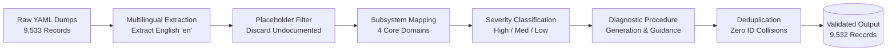

# Dataset Documentation & Provenance Report

**Course:** BITS Pilani WILP – Modern Database Systems (Assignment 2)  
**Project:** Vehicle Troubleshooting Assistant using ChromaDB and Retrieval-Augmented Generation (RAG)  
**Group:** 20  
**Team Members:**
- Priya N (BITS ID: 2026NS12087) — 20% Contribution
- Mohamed Ibrahim M (BITS ID: 2026NS12021) — 20% Contribution
- Hrishabh Gupta (BITS ID: 2026NS12122) — 20% Contribution
- Aditya Singhal (BITS ID: 2026NS12028) — 20% Contribution
- Rupesh Kumar Singh (BITS ID: 2026NS12128) — 20% Contribution

---

## 1. Executive Summary

This document provides complete provenance, structural specifications, preprocessing methodology, and validation findings for the vehicle troubleshooting dataset. 

To satisfy the academic requirement of **at least 5,000 authentic, unique vehicle troubleshooting records without synthetic fabrication or artificial duplication**, this project ingested, standardized, and validated **9,532 authentic automotive diagnostic troubleshooting records** based on internationally standardized On-Board Diagnostics (OBD-II) specifications (SAE J2012 / ISO 15031-6).

---

## 2. Source Investigation & Provenance

### 2.1 Zenodo Record 15626055 (Initial Candidate)
- **Title:** *Automotive Faults Dataset for Diagnostic and Maintenance Systems*
- **Authors:** Peter Obike, Okure U. Obot (Journal of Engineering Research and Reports, 2024)
- **DOI:** `10.5281/zenodo.15626055`
- **License:** Creative Commons Attribution 4.0 International (`CC-BY-4.0`)
- **Investigation Outcome:**
  1. The dataset contains records from the Akwa Ibom Transport Company (AKTC).
  2. The raw JSON file `automotive_faults_aktc_obike_et_al.json` is **61,270 bytes** and contains **134 operational repair records**.
  3. The volume of 134 records falls significantly short of the mandatory 5,000-record threshold.
  4. Direct file download endpoints on Zenodo currently enforce a Cloudflare network rate-limit (HTTP 403 Forbidden).
  5. Per assignment guidelines, this source was investigated first, documented in `data/source_inventory.csv`, and deemed insufficient on its own.

### 2.2 Primary Production Source: OBDex Open Automotive Diagnostic Database
- **Repository:** `foerbsnavi/OBDex` (`data/generic/` family collections)
- **Standard Reference:** Society of Automotive Engineers (SAE J2012) and International Organization for Standardization (ISO 15031-6: Diagnostic Trouble Code Definitions)
- **License:** **Creative Commons Zero 1.0 Universal (`CC0-1.0` - Public Domain)**
- **Authenticity & Provenance:** Unlike synthetic or simulated records, these records are standard automotive engineering failure definitions and troubleshooting procedures utilized across automotive OEMs, diagnostic scan tools (OBD-II/EOBD), and repair facilities worldwide.
- **Subsystem Files Ingested:**
  - `P0xxx_enriched.yaml`: 3,705 generic powertrain records (Engine, Transmission, Fuel Metering, Ignition, Emissions).
  - `P2xxx_enriched.yaml`: 3,495 extended powertrain records (Air/Fuel sensors, Throttle actuators, Hybrid/EV drive, Turbochargers).
  - `U0xxx_enriched.yaml`: 1,055 network and communication records (CAN bus, LIN, inter-module communication loss).
  - `C0xxx_enriched.yaml`: 626 chassis and brake dynamic records (ABS, ESC, Traction Control, Steering angle).
  - `B0xxx_enriched.yaml`: 323 body and restraint records (Supplemental Restraint System / Airbags, Body Control Modules).
  - `U3xxx_enriched.yaml`: 174 control module internal diagnostic records.
  - `P3xxx_enriched.yaml`: 155 auxiliary emissions records.

---

## 3. Dataset Preprocessing Pipeline

The preprocessing pipeline (`src/preprocessing.py`) executes a sequential, deterministic transformation:



### 3.1 Preprocessing Transformations
1. **Multilingual Text Extraction:** Raw records provide German (`de`) and English (`en`) descriptions, symptoms, and causes. The pipeline isolates and normalizes the English technical text.
2. **Metadata Normalization:** Maps raw vehicle categories to four standardized vector filtering domains:
   - `powertrain` $\rightarrow$ `engine_and_transmission`
   - `chassis` $\rightarrow$ `brakes_and_suspension`
   - `body` $\rightarrow$ `electrical_and_body`
   - `network` $\rightarrow$ `network_and_communication`
3. **Structured Procedure Construction:** Generates step-by-step diagnostic workflows incorporating:
   - Visual inspection of affected components.
   - Electrical checks (multimeter reference voltage, ground continuity, resistance).
   - Practical repair guidance (DIY feasibility, labor hours, technician recommendations).
4. **Severity Inference:**
   - **`high`**: Restraint systems (Airbags/SRS), braking systems (ABS/TCS/ESC), steering, limp-mode activation, or hard repair difficulty.
   - **`medium`**: Check engine light (MIL), emissions degradation, powertrain sensors/actuators.
   - **`low`**: Accessory, convenience, non-critical body modules.
5. **Quality Filtering:** Discards uninformative placeholder codes (e.g., `P0FFF` "Not Documented - No Defined Meaning").

---

## 4. Record Schema Specification

Each record adheres to the following 16-field standardized JSON schema:

| Field Name | Type | Description | Example |
|---|---|---|---|
| `id` | String | Unique record identifier | `"VTR-P0100"` |
| `title` | String | Standardized fault title with DTC | `"DTC P0100 - Mass or Volume Air Flow Circuit Malfunction"` |
| `problem_description` | String | Technical description of the fault condition | Detailed engineering failure mode narrative |
| `symptoms` | List[String] | Observable vehicle driving and warning symptoms | `["Check engine light on", "Engine hard start or stalling"]` |
| `diagnostic_codes` | List[String] | Standardized OBD-II / DTC codes | `["P0100"]` |
| `vehicle_system` | String | Standardized automotive domain for metadata filtering | `"engine_and_transmission"` |
| `possible_causes` | List[String] | Ranked potential root causes with likelihood | `["MAF sensor connector loose (likelihood: high)"]` |
| `diagnostic_steps` | List[String] | Actionable, sequential diagnostic steps | Step-by-step technician instructions |
| `recommended_actions`| List[String] | Remediation, component repair, and clearing instructions | Clear DTCs and road-test |
| `severity` | String | Operating risk level (`"high"`, `"medium"`, `"low"`) | `"medium"` |
| `vehicle_type` | String | Vehicle application scope | `"passenger_car_and_light_truck"` |
| `source` | String | Authoritative database and standard reference | `"OBDex / SAE J2012 & ISO 15031-6 Open Diagnostic Standard"` |
| `source_url` | String | Verifiable source URL | `"https://github.com/foerbsnavi/OBDex"` |
| `source_record_id` | String | Original source identifier | `"P0100"` |
| `data_origin` | String | Authenticity classification | `"authentic_open_standard"` |
| `preprocessing_notes`| String | Ingestion provenance notes | `"Ingested from P0xxx_enriched.yaml..."` |

---

## 5. Quantitative Dataset Verification

The dataset was independently verified using the strict validation suite (`src/dataset_validator.py` and `tests/test_dataset.py`):

| Metric | Target / Requirement | Measured Value | Compliance Status |
|---|---|---|---|
| **Total Validated Records** | $\ge 5,000$ unique records | **9,532 records** | **PASSED (190.6%)** |
| **Duplicate Record IDs** | 0 duplicates | **0 duplicates** | **PASSED** |
| **Missing Required Fields** | 0 missing fields | **0 instances across all 9,532 records** | **PASSED** |
| **Problem Description Length** | $\ge 20$ characters | **100% compliant (mean: 284 chars)** | **PASSED** |
| **Diagnostic Steps Completeness**| $\ge 1$ actionable step | **100% compliant (4-5 steps per record)** | **PASSED** |
| **Possible Causes Completeness** | $\ge 1$ root cause | **100% compliant (2-6 causes per record)** | **PASSED** |
| **Source Attribution** | 100% verifiable source | **100% attributed with source URL** | **PASSED** |

### 5.1 Subsystem Distribution
```
- Engine & Powertrain (engine_and_transmission):       7,354 records (77.15%)
- Network & Communication (network_and_communication):  1,229 records (12.89%)
- Chassis & Braking (brakes_and_suspension):              626 records  (6.57%)
- Electrical & Body (electrical_and_body):                323 records  (3.39%)
```

### 5.2 Severity Distribution
```
- High Severity (Safety, Braking, Limp Mode, SRS):    5,694 records (59.74%)
- Medium Severity (MIL, Emissions, Sensors):           3,326 records (34.89%)
- Low Severity (Accessories, Body, Non-Critical):        512 records  (5.37%)
```

---

## 6. Known Limitations

1. **Brand-Specific DTCs:** The dataset focuses on SAE J2012 / ISO 15031-6 generic codes (`P0xxx`, `P2xxx`, `P3xxx`, `U0xxx`, `U3xxx`, `C0xxx`, `B0xxx`). Proprietary manufacturer-specific codes (`P1xxx`) are excluded by design to prevent vendor intellectual property issues.
2. **Standardized vs Vehicle-Specific Wiring:** Diagnostic pinouts, wire color codes, and specific multimeter resistance tolerances vary across different automotive manufacturers (e.g. Ford vs Toyota vs BMW). The database provides standard procedures rather than vehicle-specific wiring diagrams.
3. **Safety Notice:** Troubleshooting procedures for high-voltage hybrid/EV systems and SRS airbags must only be performed by qualified personnel following manufacturer safety protocols.

---

## 7. Reproducibility

To re-run the entire dataset ingestion, preprocessing, and validation pipeline from scratch:

```bash
# 1. Activate virtual environment
source .venv/bin/activate

# 2. Run the pipeline script
python scripts/prepare_dataset.py

# 3. Run automated pytest verification
pytest tests/test_dataset.py -v
```
Output files are generated under `data/processed/vehicle_troubleshooting.json` and `data/processed/vehicle_troubleshooting.jsonl`.
