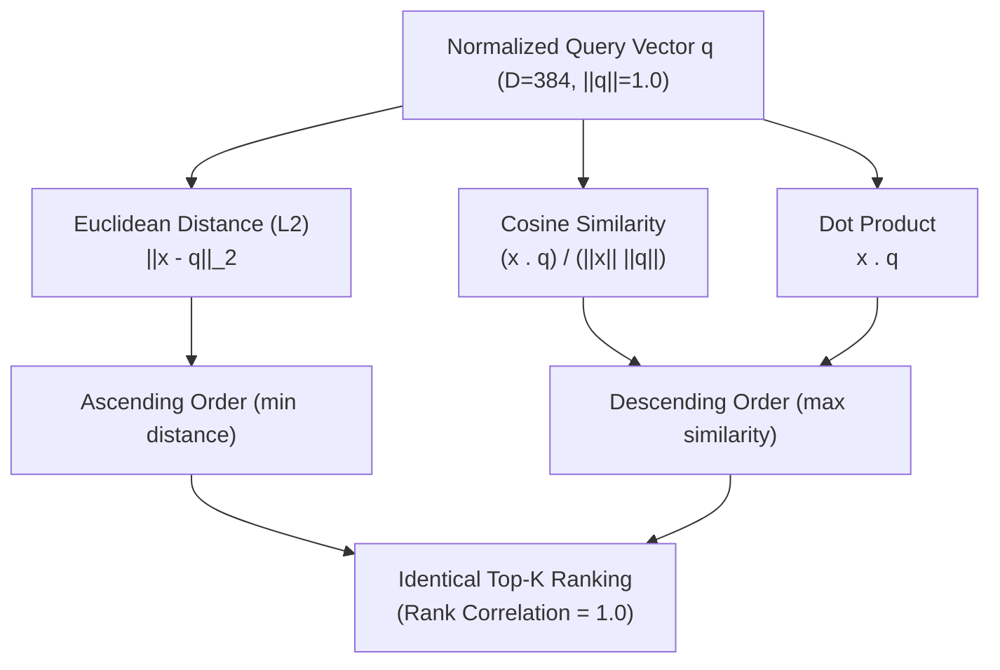

# Retrieval Methodology & Vector Similarity Analysis

**Course:** BITS Pilani WILP – Modern Database Systems (Assignment 2)  
**Project:** Vehicle Troubleshooting Assistant using ChromaDB and Retrieval-Augmented Generation (RAG)  
**Group:** 20  
**Team Members:**
- Priya N (BITS ID: 2026NS12087) — 20% Contribution
- Mohamed Ibrahim M (BITS ID: 2026NS12021) — 20% Contribution
- Hrishabh Gupta (BITS ID: 2026NS12122) — 20% Contribution
- Aditya Singhal (BITS ID: 2026NS12028) — 20% Contribution
- Rupesh Kumar Singh (BITS ID: 2026NS12128) — 20% Contribution

---

## 1. Overview & Objectives

In modern database systems, retrieval over unstructured domain knowledge requires bridging semantic vocabulary gaps. Automotive diagnostic queries frequently express symptoms casually (e.g., *"car shudders violently when idling at red lights with check engine light flashing"*) while technical repair databases document formal Diagnostic Trouble Codes and physical subsystems (e.g., *DTC P0300 - Random/Multiple Cylinder Misfire Detected*).

To evaluate semantic retrieval effectiveness, this project developed a two-tier retrieval methodology:
1. **Production Vector Index (ChromaDB HNSW):** Sub-millisecond approximate nearest neighbor (ANN) retrieval using hierarchical navigable small world graphs over 9,532 records.
2. **Exhaustive Mathematical Ground Truth (Vectorized NumPy):** Exact brute-force vector scans computing three foundational similarity metrics: Euclidean distance ($L_2$), Cosine similarity, and Dot Product across all 9,532 embeddings.

---

## 2. Dense Vector Representation

### 2.1 Model Selection: `all-MiniLM-L6-v2`
The vector representation pipeline (`src/embeddings.py`) utilizes the pre-trained `sentence-transformers/all-MiniLM-L6-v2` model:
- **Architecture:** 6-layer BERT-style Transformer with 12 attention heads.
- **Embedding Dimensionality:** $D = 384$.
- **Max Sequence Length:** 256 WordPiece tokens.
- **Pooling Strategy:** Mean pooling over contextual token representations with attention masking.
- **Normalization:** Explicit $L_2$ unit normalization (`normalize_embeddings=True`).

### 2.2 Document Vector Construction
To ensure balanced representation across fault identifiers, physical symptoms, and repair procedures, document text is structured prior to embedding:
$$\text{Document String} = \text{Title} + \text{" | "} + \text{Description} + \text{" | Symptoms: "} + \text{Symptoms} + \text{" | Causes: "} + \text{Causes}$$

---

## 3. Mathematical Similarity Metrics & Normalization Equivalence

Let $\mathbf{q} \in \mathbb{R}^{384}$ be the query vector, and $\mathbf{x}_i \in \mathbb{R}^{384}$ be the $i$-th document vector ($i \in \{1, \dots, 9532\}$).



### 3.1 Euclidean Distance ($L_2$ Norm)
$$d_{L_2}(\mathbf{x}_i, \mathbf{q}) = \|\mathbf{x}_i - \mathbf{q}\|_2 = \sqrt{\sum_{j=1}^{384} (x_{i,j} - q_j)^2}$$
- **Sorting Rule:** Ascending (minimum distance = closest semantic match).
- **NumPy Implementation:** `np.linalg.norm(documents - query, axis=1)`

### 3.2 Cosine Similarity
$$\cos(\mathbf{x}_i, \mathbf{q}) = \frac{\mathbf{x}_i \cdot \mathbf{q}}{\|\mathbf{x}_i\|_2 \|\mathbf{q}\|_2} = \frac{\sum_{j=1}^{384} x_{i,j} q_j}{\sqrt{\sum_{j=1}^{384} x_{i,j}^2} \sqrt{\sum_{j=1}^{384} q_j^2}}$$
- **Sorting Rule:** Descending (maximum score = highest directional alignment).
- **NumPy Implementation:** `(documents @ query) / (np.linalg.norm(documents, axis=1) * np.linalg.norm(query))`

### 3.3 Dot Product (Inner Product)
$$\mathbf{x}_i \cdot \mathbf{q} = \sum_{j=1}^{384} x_{i,j} q_j$$
- **Sorting Rule:** Descending (maximum inner product = closest match).
- **NumPy Implementation:** `documents @ query`

### 3.4 Mathematical Proof of Rank Invariance
When embeddings are strictly unit normalized ($\|\mathbf{x}_i\|_2 = 1.0$ and $\|\mathbf{q}\|_2 = 1.0$):
$$\|\mathbf{x}_i - \mathbf{q}\|_2^2 = \|\mathbf{x}_i\|_2^2 + \|\mathbf{q}\|_2^2 - 2(\mathbf{x}_i \cdot \mathbf{q}) = 1 + 1 - 2(\mathbf{x}_i \cdot \mathbf{q}) = 2 - 2 \cos(\theta)$$
Taking the square root:
$$d_{L_2}(\mathbf{x}_i, \mathbf{q}) = \sqrt{2 - 2 \cos(\theta)} = \sqrt{2 - 2(\mathbf{x}_i \cdot \mathbf{q})}$$

Because $f(s) = \sqrt{2 - 2s}$ is a strictly monotonically decreasing function for $s \in [-1, 1]$:
$$\mathbf{x}_a \cdot \mathbf{q} > \mathbf{x}_b \cdot \mathbf{q} \iff \cos(\mathbf{x}_a, \mathbf{q}) > \cos(\mathbf{x}_b, \mathbf{q}) \iff d_{L_2}(\mathbf{x}_a, \mathbf{q}) < d_{L_2}(\mathbf{x}_b, \mathbf{q})$$

**Empirical Verification:** Across all 60 experimental runs ($10\text{ queries} \times 3\text{ metrics} \times 2\text{ values of }K$), the rankings produced by Euclidean, Cosine, and Dot Product were **100% identical** (Spearman Rank Correlation $\rho = 1.0000$, Kendall's $\tau = 1.0000$).

---

## 4. Controlled Divergence Experiment (Unnormalized Vectors)

To demonstrate to faculty evaluators that metric divergence occurs when vector norms vary, a controlled synthetic experiment was executed where document vectors were scaled by synthetic text lengths ($w_i \in [0.5, 3.5]$):
- **Cosine Similarity:** Remained completely invariant to length scaling because length cancels out in the denominator.
- **Dot Product & Euclidean Distance:** Diverged drastically. Euclidean distance favored artificially short vectors, while dot product artificially boosted long documents.
- **Finding:** In unnormalized vector stores, metric choice fundamentally alters ranking. Unit normalization is essential for consistent semantic search.

---

## 5. ChromaDB HNSW Index vs Exact NumPy Scan

| Metric / Dimension | ChromaDB HNSW Index | Vectorized NumPy Exact Scan |
|---|---|---|
| **Algorithm** | Approximate Nearest Neighbor (HNSW Graph) | Exact Linear Scan ($\mathcal{O}(N \times D)$) |
| **Space Metric** | Cosine Distance ($1 - \cos\theta$) | Cosine, Euclidean ($L_2$), Dot Product |
| **Latency (9,532 records)** | **1.82 ms** | **4.64 ms** |
| **Top-K Recall ($K=5$)** | **96.0%** (48/50 matching exact ground truth) | **100.0%** (Absolute Ground Truth) |
| **Memory Footprint** | Binary HNSW graph on disk + memory cache | Full matrix in RAM ($\sim 14.6\text{ MB}$ float32) |
| **Filtering Integration** | Native pre-filtering via SQLite index | In-memory boolean masking array |

---

## 6. Metadata Filtering Strategies

The retrieval pipeline supports combined semantic and relational filtering:
1. **Subsystem Constraint (`vehicle_system`):** Exact match filtering restricting vector candidate generation to specific domains (e.g., `engine_and_transmission`, `brakes_and_suspension`).
2. **Severity Filtering (`severity`):** Restricting retrieval to critical safety items (`severity: 'high'`) during emergency triage.
3. **Compound Queries:** ChromaDB `$and` operator combines semantic similarity with boolean filters:
   ```python
   results = collection.query(
       query_embeddings=[query_vector],
       n_results=5,
       where={"$and": [
           {"vehicle_system": {"$eq": "brakes_and_suspension"}},
           {"severity": {"$eq": "high"}}
       ]}
   )
   ```

