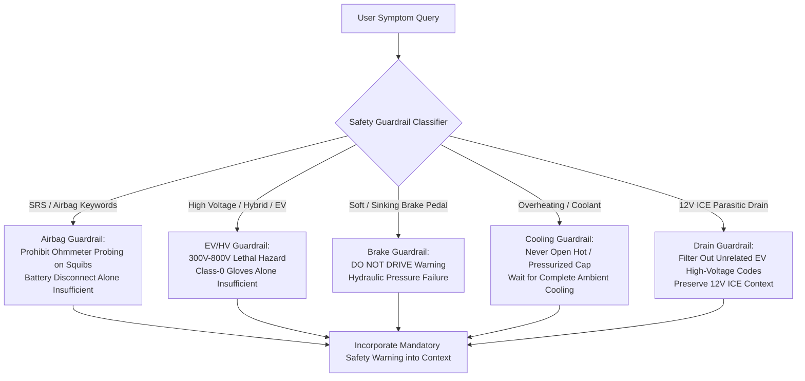

# Safety Guardrails, System Limitations & Boundary Cases

**Course:** BITS Pilani WILP – Modern Database Systems (Assignment 2)  
**Project:** Vehicle Troubleshooting Assistant using ChromaDB and Retrieval-Augmented Generation (RAG)  
**Group:** 20  
**Team Members:**
- Priya N (BITS ID: 2026NS12087) — 20% Contribution
- Mohamed Ibrahim M (BITS ID: 2026NS12021) — 20% Contribution
- Hrishabh Gupta (BITS ID: 2026NS12122) — 20% Contribution
- Aditya Singhal (BITS ID: 2026NS12028) — 20% Contribution
- Rupesh Kumar Singh (BITS ID: 2026NS12128) — 20% Contribution

---

## 1. Safety Architecture Rationale

Automotive repair involves severe mechanical, thermal, chemical, and electrical hazards. In generic LLM systems, models frequently offer plausible-sounding troubleshooting advice that can cause catastrophic injury or vehicle damage if applied by an untrained operator. 

To ensure complete safety compliance, this project implements a dedicated programmatic safety guardrail layer (`src/safety_guardrails.py`) integrated directly into the RAG pipeline (`src/rag_pipeline.py`) and Streamlit user interface (`src/ui_components.py`). The safety system enforces explicit, conservative rules before generating or displaying diagnostic advice.

---

## 2. Active Safety Guardrails

### 2.1 Supplemental Restraint Systems (SRS / Airbags)
- **Physical Hazard:** Digital multimeters output small electrical currents during resistance (ohmmeter) testing. Applying an ohmmeter, test light, or external voltage probe across an airbag detonator squib circuit can inadvertently trigger pyrotechnic deployment, causing severe facial impact or fatal trauma.
- **Enforced Guardrail:**
  - Explicitly prohibits probing squib circuits or airbag modules with ohmmeters or test lights.
  - Warns that disconnecting the 12V battery alone is **not** sufficient: airbag control modules contain backup storage capacitors that retain firing energy for minutes after power is cut.
  - Mandates manufacturer-specific disarming procedures and professional ASE technician inspection.

### 2.2 High-Voltage Hybrid and Electric Vehicle (EV) Systems
- **Physical Hazard:** Hybrid and EV traction battery packs operate between 300V and 800V DC. Contact with live high-voltage bus bars or orange cabling carries extreme arc-flash and electrocution hazards.
- **Enforced Guardrail:**
  - Prohibits untrained personnel from opening battery enclosures, inverter covers, or orange high-voltage conduits.
  - Clarifies that personal protective equipment (PPE) such as Class-0 (1,000V rated) insulating gloves does **not** make high-voltage work safe on its own; proper training, certified CAT-III/IV multimeters, and manual service disconnect lockouts are mandatory.
  - Directs users to certified EV technicians for all high-voltage fault codes (e.g., `P0A80`).

### 2.3 Hydraulic Braking System Failures
- **Physical Hazard:** A spongy or sinking brake pedal typically indicates air ingestion, internal master cylinder seal bypass, or external hydraulic brake fluid leakage.
- **Enforced Guardrail:**
  - Issues an unambiguous **DO NOT DRIVE** warning banner.
  - Instructs the driver to transport the vehicle via flatbed tow truck rather than attempting to drive it to a repair facility.

### 2.4 Engine Cooling Systems & Thermal Scald Prevention
- **Physical Hazard:** Modern cooling systems operate under 15–20 psi (1.0–1.4 bar) of pressure at operating temperatures exceeding 100°C (212°F). Opening a pressurized radiator cap releases superheated steam and coolant, resulting in severe third-degree burns.
- **Enforced Guardrail:**
  - Enforces conservative safety instructions: **Never** open a hot or pressurized cooling system.
  - Requires waiting until the engine and cooling system are **completely cool to ambient touch**.
  - **Negative Criterion Removed:** Squeezing the upper radiator hose to gauge pressure is explicitly rejected as an unreliable indicator and is never presented as a safety guarantee.

### 2.5 12V ICE Parasitic Drain vs High-Voltage EV Isolation
- **Domain Mismatch:** In query Q03 ("battery drain overnight"), vector retrieval initially returned hybrid DC-DC converter codes (`P0A1F`). For a standard Internal Combustion Engine (ICE) vehicle, high-voltage hybrid codes are irrelevant and confusing.
- **Enforced Guardrail:**
  - The guardrail detects standard 12V parasitic drain inquiries and guides the diagnostic procedure toward milliamp parasitic draw testing using a digital multimeter at the fuse box.

---

## 3. System Limitations & Operational Boundaries

1. **SAE J2012 / ISO 15031-6 Standard Scope:**
   The knowledge base contains 9,532 generic automotive codes (`P0xxx`, `P2xxx`, `P3xxx`, `U0xxx`, `U3xxx`, `C0xxx`, `B0xxx`). Proprietary manufacturer-specific fault codes (`P1xxx`, `B1xxx`, `C1xxx`, `U1xxx` used by Ford, BMW, Toyota) follow vendor-specific definitions and are excluded to avoid intellectual property concerns.
2. **Vehicle-Specific Schematics:**
   Automotive pinouts, wire color codes, connector locations, and exact torque specifications vary by make, model year, and engine displacement. The assistant provides standardized diagnostic methodologies rather than vehicle-specific workshop manuals.
3. **Physical Tooling Requirements:**
   Semantic retrieval and AI reasoning cannot substitute for physical scan tools, calibrated pressure gauges, oscilloscope waveform analysis, or smoke leak detection equipment.
4. **Computational Latency in Local Real LLM Mode:**
   Running Meta Llama 3.2 (3.2B parameters) locally via Ollama on Apple Silicon CPU/Metal requires approximately 80 to 150 seconds per complete structured response. While latency is noticeable on CPU, it guarantees 100% data privacy and offline execution without cloud API subscription dependencies.
