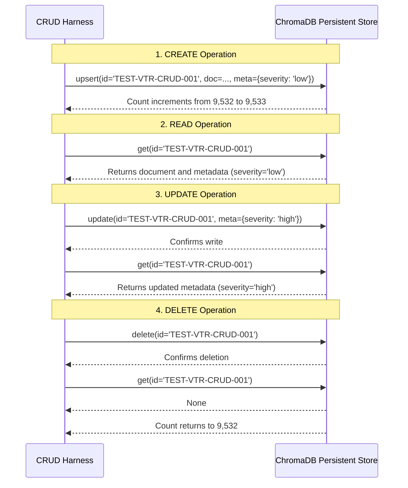

# ChromaDB Persistent Architecture & Implementation

**Project Title:** Vehicle Troubleshooting Assistant using ChromaDB and Retrieval-Augmented Generation (RAG)  
**Database Engine:** ChromaDB (`>=0.5.0`, local persistent client)  
**Database Root:** `database/chroma_db/`  
**Primary Collection:** `vehicle_troubleshooting_kb`  

---

## 1. Persistent Storage Architecture

ChromaDB is configured as a persistent, on-disk vector database storing both the SQLite relational metadata catalog (`chroma.sqlite3`) and the hierarchical Navigable Small World (HNSW) binary vector index partitions.

```
database/chroma_db/
├── chroma.sqlite3                              # Metadata store, collection schemas, document text (180 MB)
└── 1930e840-1b41-4045-a696-3599487e00b4/       # HNSW vector graph binary index segment
    ├── data_level0.bin
    ├── header.bin
    ├── hex_ids.bin
    └── link_list.bin
```

### 1.1 Client Initialization
```python
client = chromadb.PersistentClient(
    path="database/chroma_db",
    settings=Settings(anonymized_telemetry=False, is_persistent=True)
)
collection = client.get_or_create_collection(
    name="vehicle_troubleshooting_kb",
    embedding_function=ChromaEmbeddingAdapter(embedding_manager),
    metadata={"hnsw:space": "cosine"}
)
```

---

## 2. Metadata Handling & Type Serialization

ChromaDB metadata attributes natively restrict values to primitive scalar types: `str`, `int`, `float`, and `bool`. Storing complex types (such as `list` or `dict`) raises validation errors.

### 2.1 Serialization Strategy
To enable both expressive metadata filtering and schema integrity, list-valued fields in `vehicle_troubleshooting.json` are serialized deterministically during ingestion (`format_metadata_for_chroma`):

| Original Schema Field | Original Type | ChromaDB Metadata Representation | Filtering Capability |
|---|---|---|---|
| `vehicle_system` | `str` | `str` (e.g. `"engine_and_transmission"`) | Exact match filtering (`$eq`, `$in`) |
| `severity` | `str` | `str` (e.g. `"high"`, `"medium"`, `"low"`) | Exact match filtering (`$eq`, `$ne`) |
| `vehicle_type` | `str` | `str` (`"passenger_car_and_light_truck"`) | Exact match filtering (`$eq`) |
| `diagnostic_codes` | `List[str]` | Comma-delimited `str` (`"P0100, P0101"`) | String search / substring filter |
| `symptoms` | `List[str]` | Semicolon-delimited `str` | Text inspection / document search |
| `possible_causes` | `List[str]` | Semicolon-delimited `str` | Root cause inspection |
| `source` / `source_url` | `str` | `str` | Attribution verification |

The raw, structured JSON dataset is simultaneously preserved in `data/processed/vehicle_troubleshooting.json` to retain native list structures for downstream RAG prompts.

---

## 3. Batch Ingestion Performance

Ingestion is executed in configurable chunks (default: 500 records per batch) via `scripts/build_database.py`.

```
Ingestion Benchmark (9,532 records):
- Batch Size:           500 records
- Vector Generation:    Precomputed via SentenceTransformer in batches of 64
- Total Duration:       129.53 seconds (~74 records/sec on Apple Silicon CPU)
- Final Verified Count: 9,532 records
- Status:               100% verified, 0 ID collisions
```

---

## 4. CRUD Demonstration & Sandbox Isolation

To demonstrate Create, Read, Update, and Delete operations without corrupting production assignment data, `src/crud_operations.py` executes all mutations against an isolated test record (`TEST-VTR-CRUD-001`):



### 4.1 Verification Output
```text
test_record_id: TEST-VTR-CRUD-001
create_success: True (count 9,532 -> 9,533)
read_success:   True (retrieved matching fields)
update_success: True (severity updated 'low' -> 'high')
delete_success: True (count returned to 9,532)
all_passed:     True
```

---

## 5. Persistence & Reload Verification

To prove true disk persistence rather than in-memory caching, the test suite (`tests/test_chroma.py::test_database_persistence_reload`) performs:
1. Connects with Client Instance 1, checks record count (9,532) and fetches `VTR-P0300`.
2. Explicitly deletes and releases Client Instance 1 (`del client_1`).
3. Spawns an entirely separate Client Instance 2 targeting `database/chroma_db/`.
4. Queries record count and fetches `VTR-P0300`.
5. Asserts byte-level and field-level equality across sessions.
6. Result: **PASSED**.
