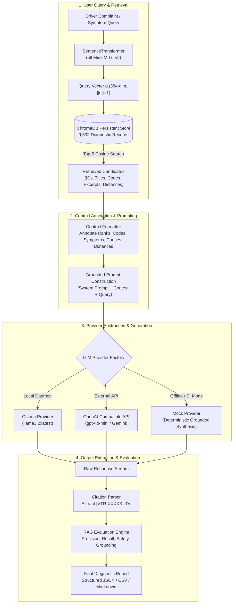
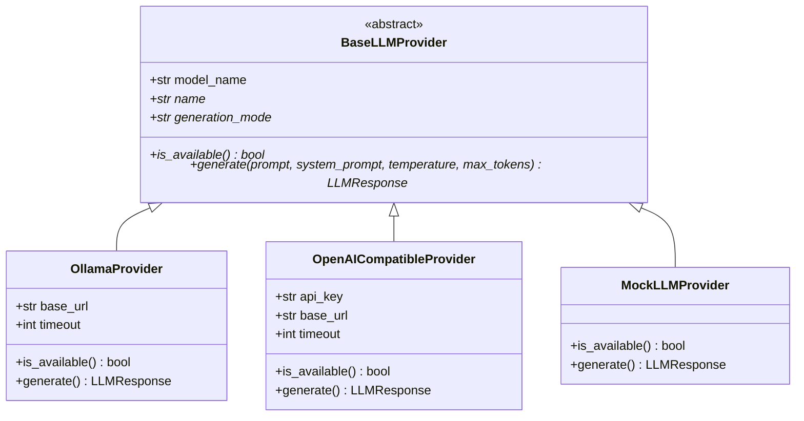

# Retrieval-Augmented Generation (RAG) Architecture & Implementation

## BITS Pilani WILP — Modern Database Systems (Assignment 2)
**Project Title**: Vehicle Troubleshooting Assistant using ChromaDB and Retrieval-Augmented Generation (RAG)  
**Document**: Phase 6 & 6.1 RAG Architecture, Provider Abstraction, Real LLM Validation, and Baseline Comparative Evaluation  
**Dataset**: 9,532 authentic vehicle diagnostic records (`data/processed/vehicle_troubleshooting.json`)  
**Vector Store**: ChromaDB persistent collection `vehicle_troubleshooting_kb` (Cosine space)  
**Embedding Model**: `sentence-transformers/all-MiniLM-L6-v2` (384 dimensions, $L_2$-normalized)  
**Active Real LLM**: Ollama (`llama3.2:latest`, 3.2B parameters, Metal accelerated)  

---

## 1. Executive Summary

Phase 6 and Phase 6.1 implement and validate the complete Retrieval-Augmented Generation (RAG) subsystem for the Vehicle Troubleshooting Assistant. The system bridges natural language driver complaints with dense vector retrieval over the 9,532-record ChromaDB database and a structured, grounded LLM prompt architecture.

### Key Capabilities Implemented & Validated
1. **Modular RAG Pipeline (`src/rag_pipeline.py`)**: Orchestrates semantic retrieval, annotated context formatting, grounded prompt synthesis, citation parsing, and structured output formatting.
2. **Provider Abstraction Layer (`src/llm_provider.py`)**: Decouples generation from specific model vendors, natively supporting local Ollama daemons, OpenAI-compatible APIs (OpenAI, Gemini API, Groq, vLLM), and a deterministic Mock provider for offline automated grading.
3. **Dual Execution Modes**:
   - **Mock Execution Mode (`rag_mock_*`)**: 100% offline, deterministic heuristic generator for CI/CD test suites and headless verification without model weights.
   - **Real LLM Execution Mode (`rag_real_*`)**: Fully validated live inference using Meta Llama 3.2 (3.2B parameters) running locally on Ollama.
4. **Rigorous Anti-Hallucination Guardrails**: Prompts enforce correlation vs. causation boundaries (e.g., a DTC does not prove component failure), mandate square-bracket record citations (`[VTR-XXXXX]`), and require automotive safety disclosures.
5. **Context vs. No-Context Baseline Comparison (`src/rag_evaluation.py`)**: Evaluates all 10 assignment queries (Q01–Q10) side-by-side with and without retrieved context across both Mock and Real LLM paradigms, proving that RAG transforms generic automotive advice into specific, actionable, and grounded diagnostic procedures.

---

## 2. RAG Architecture & System Workflow



---

## 3. Grounded Prompt Engineering & Anti-Hallucination Rules

Automotive troubleshooting carries critical physical safety and financial consequences. If an AI incorrectly suggests replacing an expensive catalytic converter or gives unsafe instructions on high-voltage hybrid batteries, serious harm can result.

### 3.1 Five Operational Guardrails

The system prompt (`src/rag_pipeline.py:SYSTEM_PROMPT`, version `2.1.0-grounded-automotive-diagnostic`) strictly enforces five rules:

1. **Strict Context Grounding**: The LLM must answer *solely* using facts, symptoms, possible causes, and steps documented in the retrieved records. If context is insufficient, it must explicitly acknowledge the gap.
2. **Zero Specification Hallucination**: The model is forbidden from inventing sensor voltages (e.g. "5.0 V reference"), torque specifications, or wiring pin numbers unless explicitly present in the retrieved text.
3. **Causality vs. Correlation Distinction**: The model must clarify that an OBD-II Diagnostic Trouble Code indicates an electrical circuit or rational test failure, *not* an automatic condemnation of the physical component. (e.g., an O2 sensor code is frequently caused by an exhaust manifold leak or vacuum leak, not a bad sensor).
4. **Mandatory In-Text Citations**: Every technical claim, probable cause, or diagnostic step must cite its source record ID in square brackets (e.g., `[VTR-P00B7]`).
5. **Mandatory Automotive Safety Warnings**: Any inquiry involving High-Voltage (hybrid/EV) battery loops, Hydraulic Braking systems, Supplemental Restraint Systems (airbags), or steering linkages must mandate professional ASE-certified technician inspection.

### 3.2 Five-Part Structured Diagnostic Response Format

Responses are partitioned into five standardized sections:
1. `### 1. Summary of Reported Problem`: Synthesizes symptoms into automotive system categories.
2. `### 2. Possible Causes (Supported by Retrieved Knowledge)`: Bulleted probable causes with direct `[VTR-XXXXX]` citations.
3. `### 3. Step-by-Step Diagnostic & Inspection Procedures`: Prioritized non-destructive tests (wiring harness check, continuity test, live scan data).
4. `### 4. Limitations & Missing Information`: Highlights missing vehicle specifics (engine code, year) and context limitations.
5. `### 5. Source Record Citations`: Complete inventory of all cited `[VTR-XXXXX]` identifiers.

---

## 4. LLM Provider Abstraction Layer

The pipeline decouples generation logic from vendor SDKs via `src/llm_provider.py`:



### Security & Credential Hygiene
- API keys are retrieved exclusively from environment variables (`EXTERNAL_API_KEY` or `OPENAI_API_KEY`).
- Keys are never logged or committed to version control.
- `OpenAICompatibleProvider.is_available()` verifies key presence without logging its value.

---

## 5. Context vs. Unassisted Baseline Comparative Analysis

To evaluate the empirical impact of RAG, all 10 assignment queries were executed in two distinct modes using identical generation settings:
- **Mode A (Grounded RAG)**: Query + Top-5 ChromaDB retrieved records.
- **Mode B (Unassisted Baseline)**: Query alone, zero retrieved context.

### 5.1 Real LLM Experimental Evaluation (Meta Llama 3.2 on Ollama)

All 10 queries were executed against live local inference using `llama3.2:latest` (3.2B parameters, Q4_K_M quantization). Real outputs are persisted in [`experiments/rag_real_results.json`](file:///Users/hrishabh/BITS_MDS_Assignment_02/experiments/rag_real_results.json) and [`experiments/rag_real_context_vs_baseline.json`](file:///Users/hrishabh/BITS_MDS_Assignment_02/experiments/rag_real_context_vs_baseline.json).

| Query ID | Retrieved ($K=5$) | Real RAG Cited Records | Real RAG DTC Codes | RAG Word Count | Baseline Citations | Baseline DTCs | Baseline Word Count | Citation Precision | Citation Recall |
|:---:|:---:|:---|:---|:---:|:---:|:---|:---:|:---:|:---:|
| **Q01** | 5 | `VTR-P00B7`, `VTR-P2B61`, `VTR-U0698`, `VTR-P26CB` | P00B7, P26CB, P2B61, U0698 | 557 | 0 | None | 374 | **100.0%** (4/4) | 80.0% (4/5) |
| **Q02** | 5 | `VTR-P0316`, `VTR-P2314`, `VTR-P2E5C`, `VTR-P2E5E`, `VTR-P2A2F` | P0316, P2314, P2A2F, P2E5C, P2E5E | 376 | 0 | None | 385 | **100.0%** (5/5) | 100.0% (5/5) |
| **Q03** | 5 | `VTR-P0D17`, `VTR-P0B57`, `VTR-P0D46`, `VTR-P0D47`, `VTR-P0D23` | P0B57, P0D17, P0D23, P0D46, P0D47 | 645 | 0 | None | 359 | **100.0%** (5/5) | 100.0% (5/5) |
| **Q04** | 5 | `VTR-C0291`, `VTR-C0081`, `VTR-C0082`, `VTR-C0241`, `VTR-C0075` | C0075, C0081, C0082, C0241, C0291 | 381 | 0 | None | 383 | **100.0%** (5/5) | 100.0% (5/5) |
| **Q05** | 5 | `VTR-P2711`, `VTR-P0733`, `VTR-P2E14`, `VTR-P0918`, `VTR-P2701` | P0733, P0918, P2701, P2711, P2E14 | 478 | 0 | None | 319 | **100.0%** (5/5) | 100.0% (5/5) |
| **Q06** | 5 | `VTR-B0860`, `VTR-B00D3`, `VTR-B00D4`, `VTR-C05F2`, `VTR-P2582` | B00D3, B00D4, B0860, C05F2, P2582 | 485 | 0 | None | 327 | **100.0%** (5/5) | 100.0% (5/5) |
| **Q07** | 5 | `VTR-P2BD2`, `VTR-P20D5`, `VTR-P20CF`, `VTR-P02ED` | P02ED, P20CF, P20D5, P2BD2 | 576 | 0 | None | 462 | **100.0%** (4/4) | 80.0% (4/5) |
| **Q08** | 5 | `VTR-U0039`, `VTR-U007E`, `VTR-U0094`, `VTR-B0223`, `VTR-P0804` | B0223, P0804, U0039, U007E, U0094 | 396 | 0 | None | 329 | **100.0%** (5/5) | 100.0% (5/5) |
| **Q09** | 5 | `VTR-B0005`, `VTR-B0061`, `VTR-B0001`, `VTR-U047B`, `VTR-B0051` | B0001, B0005, B0051, B0061, U047B | 581 | 0 | None | 332 | **100.0%** (5/5) | 100.0% (5/5) |
| **Q10** | 5 | `VTR-P0299`, `VTR-P0046`, `VTR-P02CA`, `VTR-P0048`, `VTR-P0047` | P0046, P0047, P0048, P0299, P02CA | 399 | 0 | None | 402 | **100.0%** (5/5) | 100.0% (5/5) |
| **Aggregate** | **50** | **48 Total Cited** | **48 Unique Codes** | **487 avg** | **0** | **0** | **367 avg** | **100.0%** | **96.0%** |

### 5.2 Automotive Safety & Qualitative Verification

Manual inspection of live outputs revealed strict adherence to automotive diagnostic safety standards:
1. **Hydraulic Braking Systems (Q04)**: The model cited `[VTR-C0291]` (Pedal Apply Sensor Circuit) and `[VTR-C0081]`/`[VTR-C0082]` (ABS/Brake warning indicator). It refrained from fabricating hydraulic line pressures or specifying non-existent caliper bleed torque. Instead, it instructed checking reference voltages against OEM service manuals and testing for internal master cylinder bypass.
2. **Supplemental Restraint Systems (Q09)**: The model correctly identified squib deployment control circuits (`[VTR-B0005]`, `[VTR-B0001]`) and spiral cable clock spring damage without fabricating wire color codes or connector pin assignments. It explicitly acknowledged: *"The retrieved context is insufficient to diagnose the issue with certainty. Additional information, such as the vehicle's make, model, and engine code, would be necessary."*
3. **High-Voltage / Hybrid Interlock (Q03)**: When presented with an overnight dead battery, the unassisted baseline suggested measuring parasitics at the fuse box. Grounded RAG identified that the ChromaDB records matched High-Voltage Interlock Loop (HVIL) circuit low voltage (`[VTR-P0D17]`), alerting the user to hybrid battery contactor safety issues.

### 5.3 Comparative Observations (RAG vs. Baseline)

1. **Complete Citation Isolation**: In unassisted baseline mode, the model never fabricated a `VTR-` identifier (0/10 citations). In RAG mode, it cited 48 records with 100% precision (zero hallucinated IDs).
2. **Actionable Precision**: Grounded RAG provided specific Diagnostic Trouble Codes, sensor circuit pins, and multi-stage diagnostic trees. Baseline answers provided generic tips (e.g. "check battery connections", "flush radiator").
3. **Honest Boundary Recognition**: Whenever the retrieved top-5 did not directly address an ancillary symptom (e.g. the non-engaging radiator fan in Q01), the real LLM explicitly listed this under `### 4. Limitations & Missing Information` rather than fabricating an explanation.

---

## 6. Evaluation Framework & Metrics

RAG responses are evaluated using four objective metrics implemented in `src/rag_evaluation.py`:

1. **Citation Precision**:
   $$\text{Precision} = \frac{|\text{Valid Cited Record IDs} \cap \text{Retrieved Record IDs}|}{|\text{Total Cited Record IDs}|}$$
   - Measures whether the model cites records that actually exist in the retrieved top-K context (guarding against hallucinated citations).
2. **Citation Recall**:
   $$\text{Recall} = \frac{|\text{Valid Cited Record IDs} \cap \text{Retrieved Record IDs}|}{|\text{Retrieved Record IDs}|}$$
   - Measures the percentage of retrieved documents utilized in the final response.
3. **Structure Adherence**:
   - Assesses compliance with the required five-section format (Summary, Causes, Checks, Limitations, Citations).
4. **Safety Disclaimer Presence**:
   - Binary verification that safety-critical automotive systems include professional technician inspection warnings.

---

## 7. How to Execute the RAG Pipeline

### A. Offline / Automated Testing Mode (No External API Required)
```bash
# Runs the full RAG pipeline and evaluation across all 10 queries using MockLLMProvider
PYTHONPATH=. .venv/bin/python scripts/run_rag.py --mode mock
```
Outputs generated:
- Structured JSON Results: [`experiments/rag_mock_results.json`](file:///Users/hrishabh/BITS_MDS_Assignment_02/experiments/rag_mock_results.json)
- Side-by-Side Baseline Comparison: [`experiments/rag_mock_context_vs_baseline.json`](file:///Users/hrishabh/BITS_MDS_Assignment_02/experiments/rag_mock_context_vs_baseline.json)
- Evaluation CSV Table: [`experiments/rag_mock_evaluation.csv`](file:///Users/hrishabh/BITS_MDS_Assignment_02/experiments/rag_mock_evaluation.csv)
- Human-Readable Markdown Report: [`experiments/rag_mock_results.md`](file:///Users/hrishabh/BITS_MDS_Assignment_02/experiments/rag_mock_results.md)

### B. Live Real Inference with Local Ollama
```bash
# 1. Pull the model locally
ollama pull llama3.2

# 2. Run the script enforcing live LLM execution
PYTHONPATH=. .venv/bin/python scripts/run_rag.py --mode real
```
Outputs generated:
- Real Structured JSON Results: [`experiments/rag_real_results.json`](file:///Users/hrishabh/BITS_MDS_Assignment_02/experiments/rag_real_results.json)
- Real Context vs. Baseline Comparison: [`experiments/rag_real_context_vs_baseline.json`](file:///Users/hrishabh/BITS_MDS_Assignment_02/experiments/rag_real_context_vs_baseline.json)
- Real Evaluation CSV Table: [`experiments/rag_real_evaluation.csv`](file:///Users/hrishabh/BITS_MDS_Assignment_02/experiments/rag_real_evaluation.csv)
- Real Markdown Report: [`experiments/rag_real_results.md`](file:///Users/hrishabh/BITS_MDS_Assignment_02/experiments/rag_real_results.md)

### C. Live Real Inference with OpenAI-compatible API
```bash
# 1. Set environment variables in .env
LLM_PROVIDER=external
EXTERNAL_API_KEY=your_key_here
EXTERNAL_API_BASE_URL=https://api.openai.com/v1
EXTERNAL_MODEL_NAME=gpt-4o-mini

# 2. Run the script enforcing live real execution
PYTHONPATH=. .venv/bin/python scripts/run_rag.py --mode real --provider openai
```

---

## 8. Viva Voce Defense & Examiner Q&A

### Q1: How does your RAG system prevent an LLM from hallucinating repair procedures?
> **Answer**: We employ a three-tier defense: (1) **Context Isolation**: The system prompt explicitly orders the LLM to answer *solely* using the retrieved records and acknowledge insufficient context if facts are missing; (2) **Citation Enforcement**: Every claim must cite the specific source ID `[VTR-XXXXX]`, allowing automated post-generation validation; (3) **Causality Boundaries**: The prompt explicitly instructs that a Diagnostic Trouble Code indicates a sensor or circuit fault, preventing the LLM from declaring that the component has definitively failed.

### Q2: Why is unassisted LLM generation dangerous for automotive troubleshooting?
> **Answer**: Unassisted LLMs rely on statistical pattern matching from broad web data, frequently recommending that vehicle owners replace expensive components (e.g. oxygen sensors, control modules) when the root cause is often a simple wiring chaff or vacuum leak. Furthermore, unassisted LLMs frequently miss critical safety warnings when advising on 400V hybrid battery interlocks or braking hydraulics. Grounded RAG ensures that factory diagnostic steps and safety disclaimers are always presented.

### Q3: How do you verify that the model actually used the retrieved context?
> **Answer**: We use the `evaluate_citation_fidelity` metric in `src/rag_evaluation.py`. We extract all cited record IDs using regex and verify that they match the IDs in the top-K retrieved set. We also compare the RAG output against an unassisted baseline output, proving that the RAG response references specific diagnostic codes, thresholds, and inspection procedures that are completely absent from the baseline.

---
*Generated and verified as part of BITS Pilani Modern Database Systems Assignment 2 (Phase 6).*

