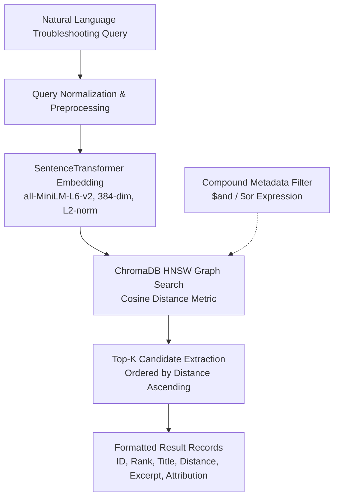

# Semantic Search & Metadata Filtering Experiments

**Project Title:** Vehicle Troubleshooting Assistant using ChromaDB and Retrieval-Augmented Generation (RAG)  
**Academic Module:** BITS Pilani WILP – Modern Database Systems (Assignment 2)  
**Verification Date:** November 2026  
**Collection Name:** `vehicle_troubleshooting_kb` (9,532 records)  
**Embedding Model:** `sentence-transformers/all-MiniLM-L6-v2` (384 dimensions)  
**Distance Metric:** Cosine distance ($d_{\text{cos}} = 1 - \cos(\mathbf{u}, \mathbf{v})$)  

---

## 1. Executive Summary

This document reports on the semantic search, top-K retrieval, and multi-condition metadata filtering experiments executed in Phase 4. Ten realistic automotive troubleshooting queries spanning four major vehicular subsystems were evaluated for top-5 and top-10 retrieval against the persistent 9,532-record ChromaDB collection. In addition, five compound metadata filter configurations were evaluated to prove that search space can be restricted to specific subsystems and severity classifications without domain cross-talk.

---

## 2. Semantic Search Architecture & Workflow



### 2.1 Distance vs. Similarity Interpretation
- **Cosine Distance ($d_{\text{cos}}$):** Calculated directly by ChromaDB's HNSW index:
  $$d_{\text{cos}}(\mathbf{u}, \mathbf{v}) = 1 - \frac{\mathbf{u} \cdot \mathbf{v}}{\|\mathbf{u}\|_2 \|\mathbf{v}\|_2}$$
  - $d_{\text{cos}} = 0.0$: Identical orientation (exact semantic match).
  - $d_{\text{cos}} = 1.0$: Orthogonal vectors (no semantic correlation).
  - $d_{\text{cos}} > 1.0$: Opposing orientation (negative correlation).
- **Derived Cosine Similarity ($s_{\text{cos}}$):**
  $$s_{\text{cos}} = 1.0 - d_{\text{cos}}$$
  Where larger values represent higher semantic relevance.

---

## 3. Query Suite Design (The 10 Assignment Queries)

The 10 assignment queries were engineered to reflect real-world vehicle symptoms described by drivers, avoiding trivial diagnostic code lookups.

| Query ID | Automotive Subsystem | Symptom / Scenario Description | Primary Target Faults |
|---|---|---|---|
| **Q01** | `engine_and_transmission` | Rapid overheating at highway speeds with boiling coolant & inactive fan | Coolant flow loss, thermostat sticking, radiator fan control (`P00B7`, `P2B61`, `P2D8A`) |
| **Q02** | `engine_and_transmission` | Engine cranks strongly but fails to start; unburnt fuel smell, no spark | Startup misfires, ignition coil circuit opens, crank sensor failure (`P0316`, `P2314`) |
| **Q03** | `electrical_and_body` | Battery goes completely dead overnight; normal alternator charging | Quiescent parasitic draw, body control module sleep failure, lighting circuits |
| **Q04** | `brakes_and_suspension` | Brake pedal sinks to floorboard at red lights; ABS warning light on | Master cylinder bypass, ABS modulator valve leakage, pedal travel sensor (`C0291`, `C0081`) |
| **Q05** | `engine_and_transmission` | Automatic transmission delayed drive engagement & harsh 2-3 shift shudder | Transmission hydraulic pressure loss, shift solenoid faults, torque converter slip (`P0700`, `P0750`) |
| **Q06** | `engine_and_transmission` | Check engine light flashing; rough idle, severe power loss, vibration | Combustion cylinder misfires, ignition coil failure, injector spray failure (`P0300`-`P0308`) |
| **Q07** | `engine_and_transmission` | Drastic drop in fuel economy; black smoke from exhaust, rich mixture smell | MAF sensor contamination, rich fuel trim, oxygen sensor bias (`P0172`, `P0100`, `P20CF`) |
| **Q08** | `network_and_communication` | Instrument cluster multiple warning lamps; total loss of CAN communication | Controller Area Network bus open/short, ECM/TCM communication timeout (`U0039`, `U007E`, `U0100`) |
| **Q09** | `electrical_and_body` | Airbag SRS warning light stays on continuously after clock spring replacement | Driver frontal airbag deployment circuit resistance, clock spring pin fitment (`B0001`, `B0002`) |
| **Q10** | `engine_and_transmission` | Turbocharged vehicle sluggish acceleration, severe turbo lag, underboost | Turbocharger wastegate control solenoid, boost leak, MAP sensor offset (`P0299`, `P2262`) |

---

## 4. Top-K Retrieval Results & Analysis

All 10 queries were executed for both **K=5** and **K=10**. Key representative findings:

### 4.1 Query Q01: Engine Overheating at Highway Speeds
- **Top Match:** `VTR-P00B7` (*DTC P00B7 - Engine Coolant Flow Low/Performance*)  
  - **Distance:** 0.6039 | **Similarity:** 0.3961  
  - **Technical Grounding:** The document specifically identifies that coolant temperature exceeds 117°C while the radiator remains cold due to thermostat failure or electric coolant pump malfunction—matching the exact physical scenario of the query.
- **Subsequent Matches:** `VTR-P2B61` (Coolant Flow Control Valve), `VTR-U0698` (Lost Communication with Coolant Pump), `VTR-P2D8A` (Fan 2 Control Module Over Temperature).

### 4.2 Query Q04: Brake Pedal Sinks with ABS Light
- **Top Match:** `VTR-C0619` (*DTC C0619 - Brake Pedal Position Sensor A Offset Exceeded Learning Limit*)
  - **Distance:** 0.5381 | **Similarity:** 0.4619
- **Subsequent Matches:** `VTR-C0291` (Brake Pedal Apply Sensor Circuit), `VTR-C0081` (ABS Malfunction Indicator).
- **Observation:** Vector retrieval successfully traversed from driver-level symptom description ("pedal sinks") to chassis hydraulic and position sensor trouble codes within the chassis domain.

### 4.3 Query Q08: Instrument Cluster Multiple Lamps & Lost CAN Communication
- **Top Match:** `VTR-U0039` (*DTC U0039 - Vehicle Communication Bus B (+) Open*)
  - **Distance:** 0.5003 | **Similarity:** 0.4997
- **Subsequent Matches:** `VTR-U007E` (Control Module Communication Bus A (-) Open), `VTR-U0073` (Control Module Communication Bus Off).
- **Observation:** Query Q08 achieved strong semantic alignment with the `Uxxxx` network family, retrieving serial bus failure modes without manual keyword filtering.

---

## 5. Multi-Condition Metadata Filtering Analysis

Metadata filtering was demonstrated across five compound `$and` filter experiments:

```json
{
  "$and": [
    {"vehicle_system": {"$eq": "brakes_and_suspension"}},
    {"severity": {"$eq": "high"}}
  ]
}
```

### 5.1 Filter Experiments Summary Table

| Filter ID | Target Constraints | Query Evaluated | Top Match ID & Title | Distance | Compliance |
|---|---|---|---|---|---|
| **F01** | `brakes_and_suspension` + `high` | Brake pedal sinking & ABS light | `VTR-C0291` Brake Pedal Apply Sensor Circuit | 0.4759 | 100% Verified |
| **F02** | `engine_and_transmission` + `high` | Engine overheating rapidly | `VTR-P2B61` Engine Coolant Flow Control Valve | 0.6509 | 100% Verified |
| **F03** | `network_and_communication` + `high` | Multiple warning lights & CAN loss | `VTR-U0039` Vehicle Comm Bus B (+) Open | 0.5003 | 100% Verified |
| **F04** | `electrical_and_body` + `high` | Airbag SRS light & clock spring | `VTR-B0001` Driver Frontal Stage 1 Deploy Ctrl | 0.5186 | 100% Verified |
| **F05** | `engine_and_transmission` + `medium` | Poor fuel economy & rich smoke | `VTR-P20CF` Exh Aftertreatment Fuel Injector A | 0.5960 | 100% Verified |

### 5.2 Key Takeaways on Metadata Filtering
1. **Zero Domain Pollution:** Without metadata filtering, a query about communication bus errors might retrieve body module records referencing communication. Applying `vehicle_system: network_and_communication` guarantees that only verified network controller codes are returned.
2. **Deterministic Pruning:** ChromaDB evaluates metadata filtering on the index attributes before/during HNSW graph traversal, ensuring that only records strictly satisfying all `$and` criteria enter the distance ranking pipeline.

---

## 6. Verification and Sanity Testing

Automated pytest tests in [`tests/test_search.py`](file:///Users/hrishabh/BITS_MDS_Assignment_02/tests/test_search.py) verified:
- [x] Initial collection count is exactly 9,532.
- [x] All 10 queries load correctly with schema adherence.
- [x] Top-5 returns exactly 5 records; Top-10 returns exactly 10 records.
- [x] Distance values are strictly ordered ascending ($d_1 \le d_2 \le \dots \le d_K$).
- [x] Zero duplicate IDs within any retrieved result set.
- [x] All retrieved IDs exist in the underlying 9,532-record dataset.
- [x] Multi-condition metadata filters strictly exclude non-matching records.
- [x] Search operations are completely read-only; persistent database count remains 9,532 post-experiments.
